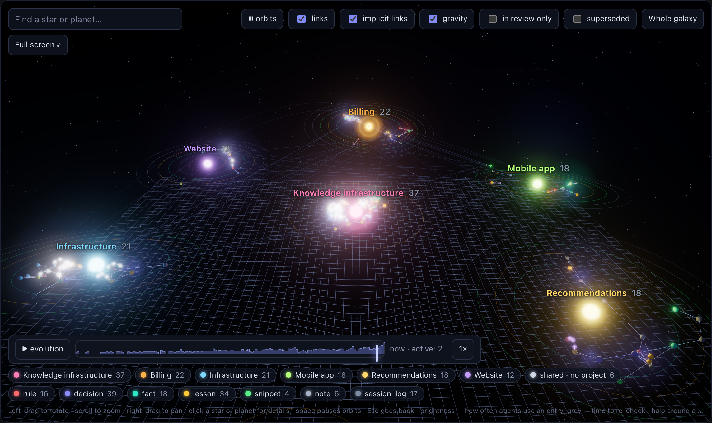
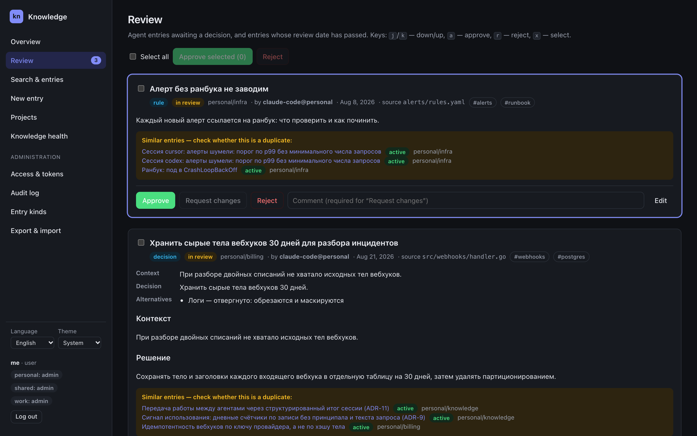
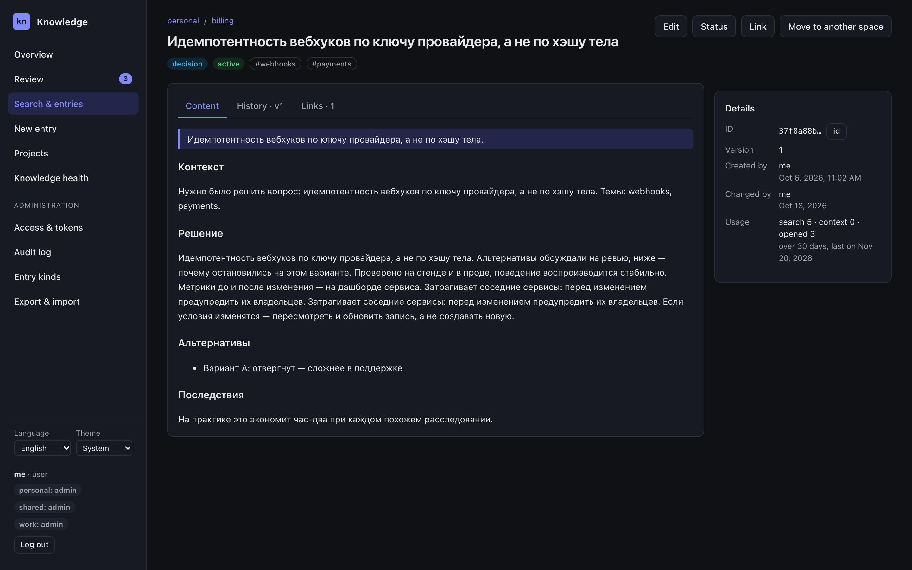
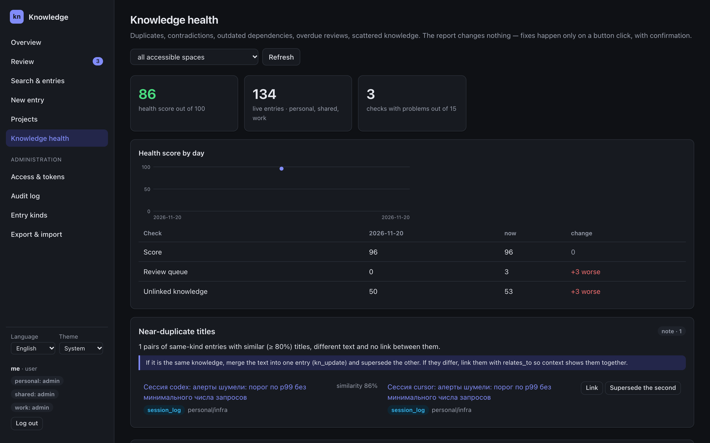
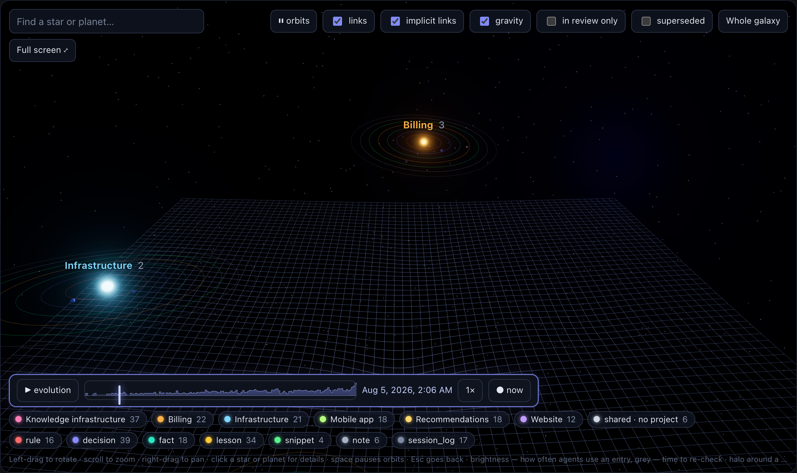

<div align="center">

# kn — shared memory for your AI agents

**One local knowledge base for Claude Code, Cursor, Codex and ChatGPT.**
Agents get the project's rules, decisions and unfinished work at the start of every task, and save what they learn
as they go. You review what becomes binding.

[](https://github.com/fill341/knowledge/actions/workflows/ci.yml)
[](LICENSE)


[Русский](README.ru.md) · [Playbook](docs/playbook.md) · [Quick start](#quick-start) · [Why kn](#why-kn-and-not-something-else)



</div>

## The problem

Every AI coding tool now has some memory — and each keeps it to itself.

- **Knowledge is scattered and lost.** A decision made with Claude Code on Monday is unknown to Cursor on Tuesday.
  `CLAUDE.md`, `.cursor/rules`, `AGENTS.md`, chat memories and notes drift apart; long sessions get compacted and
  the reasoning disappears.
- **Agents repeat mistakes.** The same pitfall is rediscovered every few weeks because the lesson was never written
  down anywhere the next agent would look.
- **Unreviewed memory is dangerous.** If an agent can silently write "facts" that every future agent trusts, one
  wrong guess spreads. Memory needs moderation, history and the ability to say "this is no longer true".
- **Work is hard to hand over.** You stop mid-task; tomorrow another tool (or another session) starts from zero.
- **Your knowledge should stay yours** — on your machine, exportable, not locked into one vendor.

kn is a small local service that fixes exactly this: a typed, moderated, versioned memory that every tool reads and
writes through MCP.

## What you get

- **Context at the start of every task** — rules, pinned entries, unfinished work, knowledge relevant to the task,
  packed into a token budget. In Claude Code it arrives automatically via a session-start hook.
- **Typed knowledge** — decisions (with alternatives), rules, facts, lessons, snippets, notes, session logs.
- **Moderation** — agents' decisions, rules and facts wait for your approval; everything else is live at once.
- **History, never deletion** — every edit is a version with diff and revert; outdated knowledge is deprecated or
  superseded, not erased.
- **Handoff between agents** — sessions end with a structured log; unfinished work shows up for the next agent in
  any tool.
- **Freshness** — facts and rules have a re-check period; overdue entries are flagged to agents and to you.
- **Health report** — duplicates, contradictions, dependencies on outdated knowledge, orphans, unused entries,
  empty searches; one-click fixes, daily trend.
- **Isolation** — `personal`, `work` and `shared` spaces; every agent has its own token and scopes.
- **The Galaxy** — a 3D map where projects are stars, entries are planets, links are gravity, projects under active
  development glow with a halo, and a player replays how your knowledge grew.
- **English and Russian UI**, light and dark theme following your system.

## Why kn and not something else

Each of these approaches is good at what it does; kn fills the gap between them.

| | Built-in memory of one tool<br><sub>CLAUDE.md, Cursor rules, chat memory</sub> | Hosted memory APIs | Notes vault + MCP<br><sub>Markdown / Obsidian</sub> | Vector DB / RAG | **kn** |
|---|:---:|:---:|:---:|:---:|:---:|
| Shared by all your AI tools | — | ✓ | ✓ | ✓ | **✓** |
| Runs locally, data stays on your machine | partly | usually not | ✓ | depends | **✓** |
| Typed knowledge (decision / rule / fact / lesson) | — | — | by convention | — | **✓** |
| Human review before knowledge becomes binding | manual | — | — | — | **✓** |
| Version history, revert, no deletion | via git | varies | via git | — | **✓** |
| Freshness, contradictions, duplicates checks | — | — | — | — | **✓** |
| Agent-to-agent handoff of unfinished work | — | — | — | — | **✓** |
| Per-agent tokens, isolated work/personal spaces | — | per API key | — | — | **✓** |
| No LLM or embeddings required | ✓ | — | ✓ | — | **✓** |

What kn is **not**: a hosted team server, a RAG engine for your documents, or a replacement for code docs. It is the
memory of *decisions and experience* around your code, for you and your agents.

## Quick start

You need **Docker** (Docker Desktop on macOS) and `make`. Go is optional — without it the CLI is built in Docker.
macOS is the first-class platform (tokens live in the Keychain).

```bash
git clone https://github.com/fill341/knowledge.git && cd knowledge
make setup                        # stack in Docker + kn CLI + your admin token (first run ≈ 3–5 min)
make connect AGENT=claude-code    # or cursor / codex — token, MCP server, hook and instructions
make ui                           # web UI, already signed in
```

That's it. Open a repository in Claude Code and start working: the agent receives context and saves knowledge.

<details>
<summary>What exactly <code>make connect</code> changes</summary>

- issues a token `<agent>@personal` (write `personal`, read `shared`) and stores it in the Keychain;
- **Claude Code**: `claude mcp add knowledge --scope user`, a `SessionStart` hook in `~/.claude/settings.json`
  (respects `CLAUDE_CONFIG_DIR`), instructions appended to `~/.claude/CLAUDE.md`;
- **Cursor**: `knowledge` server in `~/.cursor/mcp.json`; the rule text is copied to the clipboard — paste it once
  into *Settings → Rules → User Rules* (Cursor keeps user rules in your account, not on disk);
- **Codex**: `[mcp_servers.knowledge]` in `~/.codex/config.toml`, instructions in `~/.codex/AGENTS.md`.

Re-running is safe; changed JSON files get a `.bak`. Preview with `bin/kn connect <agent> --dry-run`.
A separate work profile: `make connect AGENT=cursor PROFILE=work`.
</details>

**ChatGPT** connects through OpenAI Secure MCP Tunnel (the base is never exposed to the internet) —
see [adapters/chatgpt](adapters/chatgpt/README.md). Mind that whatever ChatGPT reads goes to OpenAI.

Optional: put the CLI on your `PATH` — `export PATH="$PWD/bin:$PATH"`.

## Screenshots

| | |
|---|---|
|  |  |
| **Review** — agents propose, you approve | **Entry** — links, history with diffs, usage |
|  |  |
| **Health** — duplicates, stale knowledge, contradictions | **Evolution player** — replay how the base grew |

## How it works

```
Claude Code / Cursor / Codex / ChatGPT
            │  MCP (stdio)
            ▼
       kn-mcp (Go) ──────┐
       kn CLI   (Go) ────┤ REST + Bearer token (each agent has its own, with its own scopes)
                         ▼
                 knowledge-api (Go)   ← the only component with database access
                         │
                         ▼
               PostgreSQL 17 + full-text search          web-ui (Go BFF + React, three.js)
```

Read the **[playbook](docs/playbook.md)** for the entities, moderation, freshness, sessions and what every visual in
the Galaxy means.

## Everyday commands

| Command | |
|---------|---|
| `make ui` | web UI, signed in |
| `kn search "webhook retries"` | full-text search (English and Russian word forms) |
| `kn context --repo-from-cwd --task "…"` | the context an agent gets in this repository |
| `kn review` / `kn review approve <id>` | moderation queue |
| `kn health` | knowledge health report |
| `kn skill export [--check]` | approved rules and decisions → `.claude/skills`, `.cursor/rules`, `AGENTS.md` |
| `kn export --format jsonl` / `kn import` | full export / import (`--format markdown` for Obsidian) |
| `make backup` / `make restore-test` | backup now / prove the latest backup restores |
| `make help` | all targets |

## Localhost first

kn is built for **one person on one machine**. All ports bind to `127.0.0.1`, agents never get database credentials,
tokens live in the Keychain, the web UI keeps your token in an encrypted HttpOnly cookie and signs you in with
one-time links. There is no multi-user server mode; to share knowledge with a colleague, export a project to JSONL
and they import it into their own kn. See [SECURITY.md](SECURITY.md).

## Documentation

- [Playbook](docs/playbook.md) — how to use kn, entities, moderation, the Galaxy · [на русском](docs/playbook.ru.md)
- Design docs (in Russian): [architecture](docs/architecture.md), [data model](docs/data-model.md),
  [API](docs/api.md) ([OpenAPI](api/openapi.yaml)), [agent integration](docs/agent-integration.md),
  [security](docs/security.md), [deployment](docs/deployment.md), [roadmap](docs/roadmap.md)
- [Knowledge of this project](docs/project-knowledge.md) — decisions and lessons from building kn, exported from kn
  itself; import into your base with `kn import seed/knowledge-project.jsonl`

## Contributing

Issues and PRs are welcome — see [CONTRIBUTING.md](CONTRIBUTING.md). Known gaps: the agent-facing layer (MCP tool
descriptions, context headings) is Russian only for now; Linux works with `KN_TOKEN` instead of the Keychain but is
not polished.

## License

[MIT](LICENSE)
