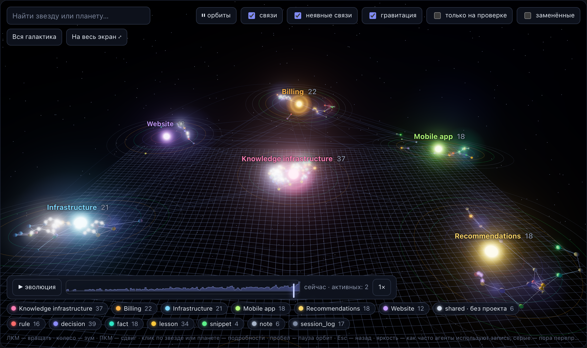
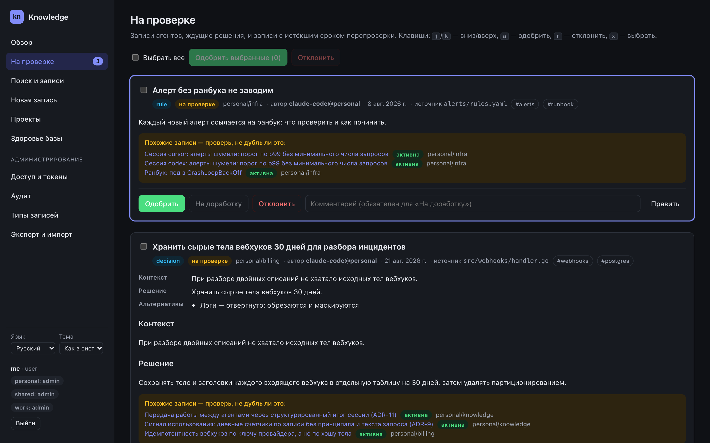
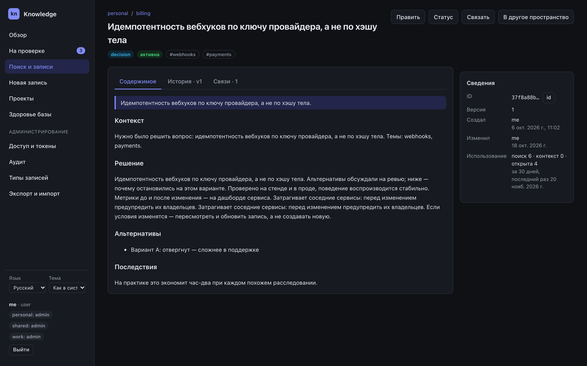
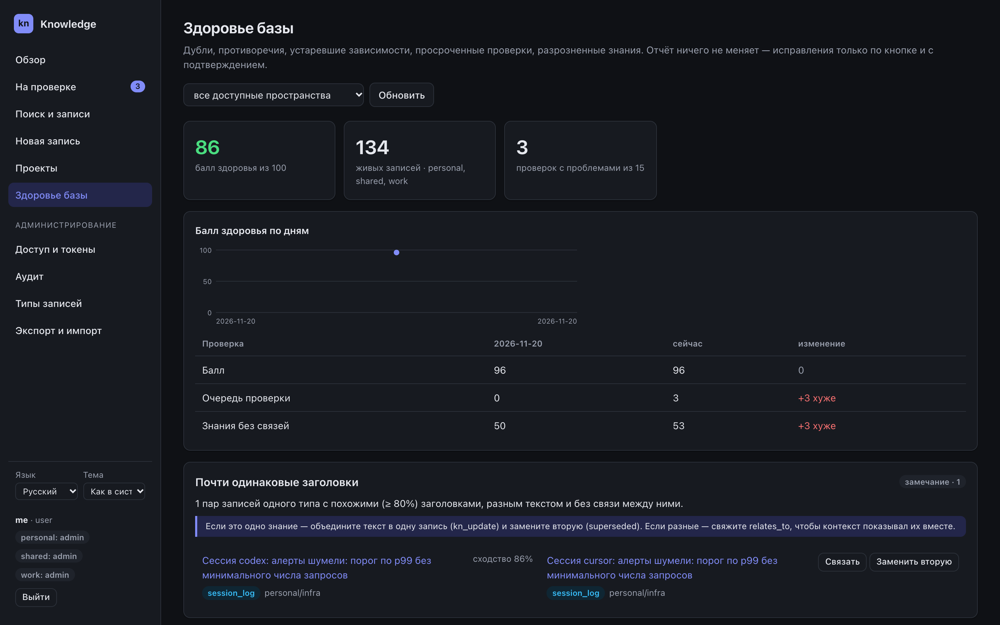
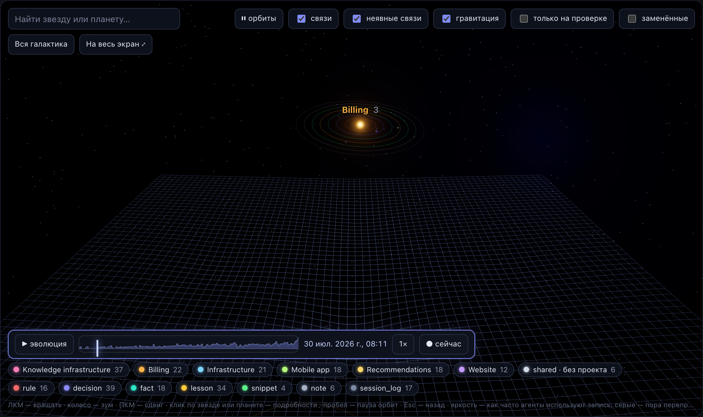

<div align="center">

# kn — общая память для AI-агентов

**Одна локальная база знаний для Claude Code, Cursor, Codex и ChatGPT.**
В начале каждой задачи агент получает правила, решения и незавершённую работу проекта, а по ходу сохраняет то, что
узнал. Что станет обязательным — решаете вы.

[](https://github.com/fill341/knowledge/actions/workflows/ci.yml)
[](LICENSE)


[English](README.md) · [Playbook](docs/playbook.ru.md) · [Быстрый старт](#быстрый-старт) · [Почему kn](#почему-kn-а-не-аналоги)



</div>

## Какую проблему решает

Память теперь есть почти у каждого AI-инструмента — и каждый держит её при себе.

- **Знания разбросаны и теряются.** Решение, принятое с Claude Code в понедельник, во вторник неизвестно Cursor.
  `CLAUDE.md`, `.cursor/rules`, `AGENTS.md`, память чатов и заметки расходятся; длинные сессии сжимаются, и
  рассуждения пропадают.
- **Агенты повторяют ошибки.** Одни и те же грабли находятся заново раз в пару недель, потому что урок не записан
  там, куда посмотрит следующий агент.
- **Непроверенная память опасна.** Если агент может молча записать «факт», которому поверят все будущие агенты,
  одна ошибочная догадка расползается. Памяти нужны модерация, история и возможность сказать «это больше не так».
- **Работу трудно передать.** Вы остановились на середине — завтра другой инструмент (или другая сессия) начинает
  с нуля.
- **Знания должны оставаться вашими** — на вашей машине, с экспортом, без привязки к одному вендору.

kn — небольшой локальный сервис, который решает именно это: типизированная, модерируемая память с историей
версий, которую все инструменты читают и пишут через MCP.

## Что вы получаете

- **Контекст в начале каждой задачи** — правила, закреплённые записи, незавершённая работа, знания по теме задачи,
  уложенные в бюджет токенов. В Claude Code приходит сам через хук старта сессии.
- **Типизированные знания** — решения (с альтернативами), правила, факты, уроки, сниппеты, заметки, итоги сессий.
- **Модерация** — решения, правила и факты от агентов ждут вашего одобрения; остальное работает сразу.
- **История вместо удаления** — каждая правка — версия с диффом и откатом; устаревшее помечается, а не стирается.
- **Передача работы между агентами** — сессия заканчивается структурированным итогом; незавершённая работа видна
  следующему агенту в любом инструменте.
- **Актуальность** — у фактов и правил есть срок перепроверки; просроченные помечаются и агентам, и вам.
- **Отчёт о здоровье** — дубли, противоречия, опора на устаревшее, записи без связей, невостребованные знания,
  пустые поиски; исправления в один клик, ежедневный тренд.
- **Изоляция** — пространства `personal`, `work`, `shared`; у каждого агента свой токен и права.
- **Галактика** — 3D-карта: проекты — звёзды, записи — планеты, связи — гравитация, у проектов в работе — гало
  активности, а плеер показывает, как росли ваши знания.
- **Интерфейс на русском и английском**, светлая и тёмная тема — по системным настройкам.

## Почему kn, а не аналоги

Каждый из подходов хорош в своём; kn закрывает промежуток между ними.

| | Встроенная память одного инструмента<br><sub>CLAUDE.md, Cursor rules, память чата</sub> | Облачные API памяти | Заметки + MCP<br><sub>Markdown / Obsidian</sub> | Векторная БД / RAG | **kn** |
|---|:---:|:---:|:---:|:---:|:---:|
| Общая для всех AI-инструментов | — | ✓ | ✓ | ✓ | **✓** |
| Локально, данные на вашей машине | частично | обычно нет | ✓ | зависит | **✓** |
| Типы знаний (решение / правило / факт / урок) | — | — | по договорённости | — | **✓** |
| Проверка человеком до того, как знание станет обязательным | вручную | — | — | — | **✓** |
| История версий, откат, без удаления | через git | по-разному | через git | — | **✓** |
| Проверки актуальности, противоречий, дублей | — | — | — | — | **✓** |
| Передача незавершённой работы между агентами | — | — | — | — | **✓** |
| Свой токен у каждого агента, изоляция work/personal | — | по API-ключу | — | — | **✓** |
| Не нужны LLM и embeddings | ✓ | — | ✓ | — | **✓** |

Чем kn **не является**: командным облачным сервером, RAG-движком по вашим документам или заменой документации к
коду. Это память о *решениях и опыте* вокруг вашего кода — для вас и ваших агентов.

## Быстрый старт

Нужны **Docker** (на macOS — Docker Desktop) и `make`. Go не обязателен: без него CLI соберётся в Docker.
Основная платформа — macOS (токены хранятся в Keychain).

```bash
git clone https://github.com/fill341/knowledge.git && cd knowledge
make setup                        # стек в Docker + CLI kn + ваш admin-токен (первый запуск ≈ 3–5 минут)
make connect AGENT=claude-code    # или cursor / codex — токен, MCP-сервер, хук и инструкция
make ui                           # веб-интерфейс, вход уже выполнен
```

Всё. Откройте репозиторий в Claude Code и работайте: агент получает контекст и сохраняет знания.

<details>
<summary>Что именно меняет <code>make connect</code></summary>

- выпускает токен `<агент>@personal` (запись в `personal`, чтение `shared`) и кладёт его в Keychain;
- **Claude Code**: `claude mcp add knowledge --scope user`, хук `SessionStart` в `~/.claude/settings.json`
  (учитывает `CLAUDE_CONFIG_DIR`), инструкция дописывается в `~/.claude/CLAUDE.md`;
- **Cursor**: сервер `knowledge` в `~/.cursor/mcp.json`; текст правила копируется в буфер — вставьте его один раз в
  *Settings → Rules → User Rules* (Cursor хранит User Rules в аккаунте, а не на диске);
- **Codex**: `[mcp_servers.knowledge]` в `~/.codex/config.toml`, инструкция в `~/.codex/AGENTS.md`.

Повторный запуск безопасен; изменённые JSON-файлы сохраняются в `.bak`. Посмотреть без изменений:
`bin/kn connect <агент> --dry-run`. Отдельный рабочий профиль: `make connect AGENT=cursor PROFILE=work`.
</details>

**ChatGPT** подключается через OpenAI Secure MCP Tunnel (база не открывается в интернет) —
см. [adapters/chatgpt](adapters/chatgpt/README.md). Помните: всё, что прочитает ChatGPT, уходит в OpenAI.

По желанию добавьте CLI в `PATH`: `export PATH="$PWD/bin:$PATH"`.

## Скриншоты

| | |
|---|---|
|  |  |
| **На проверке** — агенты предлагают, вы утверждаете | **Запись** — связи, история с диффами, использование |
|  |  |
| **Здоровье** — дубли, устаревшее, противоречия | **Плеер эволюции** — как росла база |

## Как устроено

```
Claude Code / Cursor / Codex / ChatGPT
            │  MCP (stdio)
            ▼
       kn-mcp (Go) ──────┐
       kn CLI   (Go) ────┤ REST + Bearer-токен (у каждого агента свой, со своими правами)
                         ▼
                 knowledge-api (Go)   ← единственный компонент с доступом к БД
                         │
                         ▼
               PostgreSQL 17 + полнотекстовый поиск          web-ui (Go BFF + React, three.js)
```

В **[playbook](docs/playbook.ru.md)** — сущности, модерация, актуальность, сессии и что означает каждый элемент
Галактики.

## Повседневные команды

| Команда | |
|---------|---|
| `make ui` | веб-интерфейс, вход выполнен |
| `kn search "ретраи вебхуков"` | полнотекстовый поиск (русские и английские словоформы) |
| `kn context --repo-from-cwd --task "…"` | контекст, который агент получит в этом репозитории |
| `kn review` / `kn review approve <id>` | очередь модерации |
| `kn health` | отчёт о здоровье базы |
| `kn skill export [--check]` | одобренные правила и решения → `.claude/skills`, `.cursor/rules`, `AGENTS.md` |
| `kn export --format jsonl` / `kn import` | полный экспорт и импорт (`--format markdown` — для Obsidian) |
| `make backup` / `make restore-test` | бэкап сейчас / проверить, что последний бэкап восстанавливается |
| `make help` | все цели |

## Прежде всего localhost

kn рассчитан на **одного человека на одной машине**. Все порты слушают `127.0.0.1`, агенты не получают доступа к БД,
токены хранятся в Keychain, веб-интерфейс держит токен в зашифрованной HttpOnly-куке и пускает по одноразовой
ссылке. Многопользовательского серверного режима нет: чтобы поделиться знаниями с коллегой, экспортируйте проект в
JSONL — он импортирует его в свой kn. См. [SECURITY.md](SECURITY.md).

## Документация

- [Playbook](docs/playbook.ru.md) — как пользоваться, сущности, модерация, Галактика · [in English](docs/playbook.md)
- Проектные документы: [архитектура](docs/architecture.md), [модель данных](docs/data-model.md),
  [API](docs/api.md) ([OpenAPI](api/openapi.yaml)), [интеграция агентов](docs/agent-integration.md),
  [безопасность](docs/security.md), [развёртывание](docs/deployment.md), [roadmap](docs/roadmap.md)
- [Знания этого проекта](docs/project-knowledge.md) — решения и уроки разработки kn, выгруженные из самого kn;
  импорт в свою базу: `kn import seed/knowledge-project.jsonl`

## Участие

Issues и PR приветствуются — см. [CONTRIBUTING.md](CONTRIBUTING.md). Известные пробелы: слой, который видят агенты
(описания MCP-инструментов, заголовки контекста), пока только на русском; Linux работает с `KN_TOKEN` вместо
Keychain, но не отполирован.

## Лицензия

[MIT](LICENSE)
