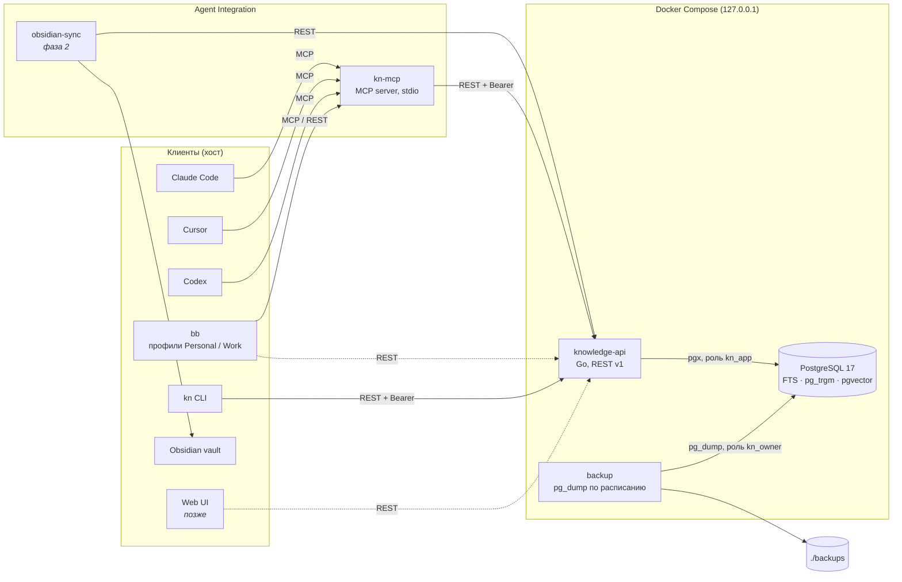
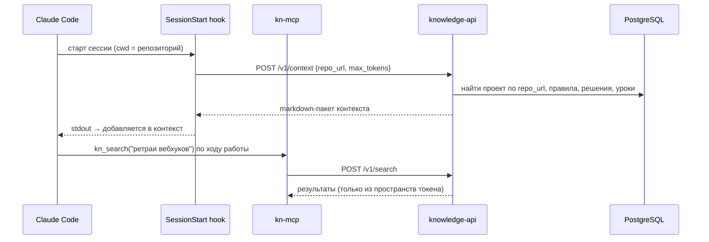

# Архитектура

## 1. Цели и ограничения

| Требование | Как обеспечивается |
|------------|--------------------|
| Provider-independent | Ядро ничего не знает об LLM. Интеграция через MCP (открытый протокол) и REST. Токены считаются эвристикой, а не токенайзером конкретной модели. |
| Local-first | Всё работает в Docker на локальной машине, порты привязаны к `127.0.0.1`, нет внешних зависимостей в рантайме. |
| Docker-based | `docker compose up` поднимает БД, миграции, API и бэкапы. |
| Personal / Work / Shared isolation | Пространства (`spaces`) + токены со scope'ами на уровне пространства. Проверка в каждом запросе к хранилищу. См. [security.md](security.md). |
| Единый источник знаний | Одна БД PostgreSQL. Obsidian, экспорт и Web UI — производные представления. |
| Независимость от bb и Obsidian | bb и Obsidian — обычные клиенты API. Ядро о них не знает. |
| Экспортируемость | `GET /v1/export` → Markdown + frontmatter и JSONL; плюс `pg_dump`. |
| История изменений | Append-only таблица `entry_versions`, заполняется триггером. У роли приложения нет прав на `DELETE`. |
| Контроль качества | Конвейер валидации при записи: схема по типу записи, провенанс, сканер секретов, дедупликация, review для агентских записей. |
| Безопасное хранение credentials | Docker secrets для паролей БД; токены агентов хранятся только как hash; у агентов — в macOS Keychain. |
| Новые агенты без изменения ядра | Новый агент = новый principal + токен + конфиг адаптера. Новые типы знаний — через реестр `entry_kinds` (данные, а не код). |

**Принципы из постановки:** без монолита; Storage, Knowledge API, MCP и адаптеры разделены; агенты не имеют прямого доступа к БД;
embeddings/RAG — не в MVP; сначала модель данных, контракты и права.

## 2. Схема компонентов



### Слои и ответственность

| Компонент | Ответственность | Чего **не** делает |
|-----------|-----------------|--------------------|
| **PostgreSQL** (Storage) | Хранение, транзакции, FTS, история (триггер), ограничения целостности. | Не знает про агентов и токены. Не доступен агентам. |
| **knowledge-api** (Knowledge Service) | Аутентификация, авторизация по пространствам, валидация и качество, CRUD, версии, поиск, сборка контекста, экспорт, аудит. | Не вызывает LLM. Не знает про MCP, Claude, Cursor, bb. |
| **kn-mcp** (Agent Integration) | Переводит MCP-инструменты в вызовы REST. Определяет текущий проект по `git remote`. | Не хранит состояние. Не ходит в БД. Не содержит бизнес-логики. |
| **Adapters** | Конфиги и хуки для конкретного инструмента (`.mcp.json`, `config.toml`, rules, SessionStart-хук), инструкции агенту. | Не содержат кода, который нужен ядру. |
| **kn CLI** | Ручная работа, скрипты, хуки, админка токенов, экспорт/импорт. | — |
| **obsidian-sync** | Экспорт в vault, позже — импорт правок с контролем версий. | Не является источником истины. |
| **backup** | Периодический `pg_dump` с ротацией. | — |

Каждый компонент — отдельный бинарник/контейнер с отдельным Go-модулем. `kn-mcp` и `kn` используют
только сгенерированный из OpenAPI клиент (`pkg/kclient`), а не внутренние пакеты API — это закрепляет границу на уровне компилятора.

## 3. Основные потоки

### 3.1. Агент начинает работу в проекте



### 3.2. Агент сохраняет результат работы

1. Агент вызывает `kn_save` / `kn_record_decision` / `kn_log_session`.
2. `kn-mcp` → `POST /v1/entries` (с `Idempotency-Key`).
3. API: проверка scope → валидация по типу → сканер секретов → дедупликация → определение статуса
   (`active` или `proposed`, если тип требует review для агентов) → запись + версия + аудит в одной транзакции.
4. Ответ содержит `id`, `status` и `warnings` (например, найдены похожие записи) — агент может связать или обновить вместо дубля.

### 3.3. Человек проверяет записи

`kn review` (или Web UI) → `GET /v1/review-queue` → `approve` / `reject` / правка. Подтверждённые записи становятся `active`
и начинают попадать в контекст.

## 4. Ключевые решения

### ADR-1. Одна БД с пространствами, а не отдельные инстансы на Personal и Work

- **Решение:** один PostgreSQL, таблица `spaces` (`personal`, `work`, `shared`), у каждой записи `space_id`, токены ограничены по пространствам.
- **Почему:** «единый источник знаний» и пространство `shared` естественно работают только в одной БД; меньше эксплуатации.
- **Цена:** изоляция логическая. Компенсируем строгим store-слоем (запрос без scope не компилируется), интеграционными тестами изоляции и RLS как вторым рубежом (фаза 2).
- **Запасной выход:** если политика работодателя требует физического разделения, тот же compose запускается вторым проектом (`name: knowledge-work`) на другом порту. Код не меняется.

### ADR-2. Единая таблица `entries` + реестр типов вместо таблицы на каждый тип

- Типы (`note`, `fact`, `decision`, `rule`, `lesson`, `document`, `snippet`, `session_log`) — строки в `entry_kinds` с JSON Schema для `attributes`.
- Общие механизмы (поиск, версии, статусы, права, экспорт) реализуются один раз.
- Новый тип знания добавляется записью в реестр, без миграции и без изменения кода.

### ADR-3. MCP-сервер — тонкий клиент REST, запускается через stdio

- Каждый инструмент сам запускает `kn-mcp` как дочерний процесс; токен приходит через env. Нет общего долгоживущего процесса, который знает все токены.
- `kn-mcp` stateless, вся логика в API → одинаковое поведение для всех агентов и для CLI.
- HTTP-режим (`--http`) — опционально, для клиентов без stdio.

### ADR-4. Сначала полнотекстовый поиск, embeddings потом

- PostgreSQL FTS с конфигурацией `russian` (стеммит кириллицу, латиница в ней обрабатывается английским стеммером) + `pg_trgm` для нечёткого поиска по заголовкам. Если поиск по всем словам почти пуст, добавляется поиск по любому
  слову с ранжированием по доле совпавших слов (выбрано по `kn eval`, roadmap этап 4).
- Расширение `pgvector` ставится сразу (образ `pgvector/pgvector`), но таблица чанков и эмбеддинги — только после того, как появятся реальные промахи FTS (метрика в аудите).
- Когда понадобится: гибридный поиск FTS + векторы, объединение через Reciprocal Rank Fusion. API `POST /v1/search` не меняется, добавляется `mode: "hybrid"`.

### ADR-5. История — триггер и запрет DELETE

- Любой `INSERT`/`UPDATE` в `entries` триггером пишет снимок в `entry_versions`. `entries.version` обязан увеличиваться.
- Роли `kn_app` выданы только `SELECT, INSERT, UPDATE` на `entries`, без `DELETE`; на `entry_versions` и `audit_log` — только `SELECT, INSERT`. Даже баг в сервисе не сотрёт историю.
- «Удаление» = статус `archived`.

### ADR-6. Контракт в OpenAPI, код без генерации

- `api/openapi.yaml` описывает весь REST v1 и проверяется линтером (`make lint`).
- **Отклонение от первоначального плана:** от `oapi-codegen`, `sqlc` и `goose` отказались при реализации MVP.
  Сервер, клиент `pkg/kclient` и SQL написаны руками: эндпоинтов немного, а три генератора добавили бы
  инструменты сборки и слой адаптеров без заметной пользы для одного разработчика.
- Соответствие кода контракту держат интеграционные тесты API (`internal/httpapi/api_test.go`).
  Если API разрастётся или появятся клиенты на других языках, генерацию можно вернуть — контракт уже есть.

### ADR-7. Идентификаторы

- UUIDv7 генерируются в приложении (сортируются по времени, удобно для курсорной пагинации). В PostgreSQL 17 нет встроенного `uuidv7()` — поэтому в приложении.

### ADR-8. Отчёт о здоровье базы: детекторы на SQL по запросу, исправления — только человеком

- **Контекст.** Аудит рабочей базы (см. [roadmap.md](roadmap.md)) показал 183 лишние копии по содержимому (22 % живых
  записей), 104 несвязанные пары почти одинаковых заголовков, 83 % структурных знаний без связей и неотслеживаемую актуальность. Существующий дедуп ловит только точные копии
  с тем же заголовком.
- **Решение.** `GET /v1/health` считает отчёт на лету SQL-запросами по пространствам, видимым токену: каждая проверка
  возвращает серьёзность, число, примеры, рекомендацию и подсказку действия. Отчёт ничего не меняет. Исправления делает
  человек существующими операциями (переход `superseded` с `superseded_by`, связи) — в UI с подтверждением.
  Агенты видят отчёт через `kn_health` и могут предлагать исправления, но не применяют массовые изменения.
- **Альтернативы.** Фоновый воркер с таблицей результатов — лишняя инфраструктура при текущем объёме (запросы на ~1000
  записей занимают миллисекунды); снимки для трендов — отдельный этап. Автоматическое слияние дублей — запрещено
  принципом «не терять знания без подтверждения человека».
- **Последствия.** Нет миграций и состояния; стоимость растёт с объёмом: на 842 записях отчёт строится ~1 с
  (самосоединение по триграммам, хэш нормализованного текста) — при десятках тысяч записей понадобятся лимиты или снимки.

### ADR-9. Сигнал использования: дневные счётчики по записи, без принципала и текста запроса

- **Контекст.** Непонятно, какие знания реально работают: аудит хранит только факт поиска и число результатов. Нужен
  сигнал «знание пригодилось», чтобы видеть невостребованные записи и запросы без ответа (roadmap P1 #4).
- **Решение.** Таблица `entry_usage (entry_id, day, shown, delivered, opened)`. Счётчики:
  - `shown` — запись была в результатах поиска;
  - `delivered` — попала в пакет `kn_context`;
  - `opened` — прочитана целиком через `GET /v1/entries/{id}` (`kn_get`, страница записи).

  Пишется одним upsert на вызов, best-effort: ошибка счётчика не ломает чтение. Не считаются прогоны `kn eval`,
  отчёт о здоровье, экспорт и служебные чтения. Отчёт о здоровье показывает невостребованные знания (после 14 дней
  сбора) и повторяющиеся поиски без результатов (по хэшу запроса).
- **Альтернативы.**
  - Журнал событий с принципалом и запросом — богаче, но хранит, кто что читал, и тексты запросов (риск секретов),
    а растёт в десятки раз быстрее.
  - Вычислять из `audit_log` — там нет id выданных записей.
  - Буст ранжирования по популярности — только после проверки `kn eval`, иначе популярное станет ещё популярнее.
- **Последствия.** Чтение начинает писать (одна строка на запись в день; при ~1000 записей — до ~365 тыс. строк в год).
  У `kn_app` есть UPDATE на `entry_usage`, DELETE нет — счётчики, как и аудит, не удаляются приложением.

### ADR-10. Контекст при переполнении: правила под потолком, отбор по задаче, оглавление вместо молчаливого отсечения

- **Контекст.** Разделы `kn_context` заполнялись строго по очереди (правила → решения по свежести → уроки → связанное
  по задаче), а не влезшее выбрасывалось. В больших проектах на «связанное по задаче» оставалось 0–1 запись;
  `kn eval` показал выпадение нужного факта при росте проекта.
- **Решение.**
  - Правила целиком, но не больше 35 % бюджета; лишнее — кратко, затем в оглавление; отчёт о здоровье
    предупреждает, если правила проекта не помещаются (`rules_budget`).
  - С задачей — один пул (поиск по проекту + поиск по пространствам + свежие решения и уроки как слабый сигнал),
    слияние рангов с поправкой на тип.
  - Без задачи — свежие решения (≤ 30 %), уроки (≤ 20 %) и факты.
  - Не влезшее — оглавление до 15 строк `id — заголовок` в резерве 10 % бюджета.
  - Бюджет по умолчанию — 10 000 токенов (сервер, MCP, CLI). Хук старта сессии — 2700: Claude Code обрезает
    вывод хука примерно до 10 000 символов (превью ~2 КБ вместо текста), а 2700 токенов ≈ 9400 символов.
- **Альтернативы.** Только квоты разделов — задача не влияет на выбор решений; только поднять бюджет — откладывает
  проблему; двухшаговый контекст — больше вызовов и зависит от дисциплины агента.
- **Последствия.** Замер `kn eval` (рабочий набор, 26 запросов с задачей и 9 без):

  | Шаг | С задачей: в контексте / досягаемо | Без задачи: в контексте / досягаемо |
  |---|---|---|
  | Было (3000) | 0,923 / — | — |
  | + оглавление (3000) | 0,962 / 1,000 | 0,944 / 0,944 |
  | + отбор по задаче и квоты (3000) | 1,000 / 1,000 | 0,944 / 1,000 |
  | + бюджет 6000 | 1,000 / 1,000 | 1,000 / 1,000 |
  | бюджет 10 000 (принят) | 1,000 / 1,000 | 1,000 / 1,000 |

  Разделы ответа с задачей — `rules`, `task`, `more`; без задачи — `rules`, `decisions`, `lessons`, `facts`, `more`.

### ADR-11. Передача работы между агентами через структурированный итог сессии

- **Контекст.** Итог сессии был свободным текстом: следующий агент — другой клиент или та же модель завтра — не знал,
  что осталось недоделанным, и начинал заново или повторял работу (roadmap P1 #5).
- **Решение.** `kn_log_session` / `POST /v1/sessions/{id}/end` принимают `goal`, `status` (`done` / `in_progress` /
  `blocked`), `done[]`, `commits[]`, `open_questions[]`, `next_steps[]`, `continues[]`. Они хранятся в атрибутах
  `session_log` (миграция 0006 расширяет схему; старые итоги валидны) и рендерятся в тело Markdown.
  - Итог со статусом `in_progress` / `blocked` — незавершённая работа. `kn_context` проекта показывает до 3 последних
    за 30 дней в разделе «Незавершённая работа» сразу после правил (≤ 15 % бюджета), пока поздний итог не укажет её
    id в `continues`.
  - Отчёт о здоровье: `stale_handoffs` — незавершённая работа старше 14 дней, которую никто не продолжил.
- **Альтернативы.**
  - Отдельная таблица задач — дублирует трекеры и требует ручного закрытия.
  - Автозакрытие по факту показа в контексте — агент мог увидеть и не продолжить.
  - Хранить handoff в `agent_sessions` — сессии привязаны к принципалу, а работу подхватывает другой агент.
- **Последствия.** Закрытие явное (`continues`) или по сроку (30 дней из контекста). Видимость — по пространству,
  как у любой записи: незавершённая работа Work-агента не попадает в Personal.

### ADR-12. Сроки актуальности: срок у типа записи, дата перепроверки вычисляется при чтении

- **Контекст.** Ни у одной записи не было даты перепроверки; старые факты выдавались наравне со свежими (roadmap P2 #6).
- **Решение.** `entry_kinds.review_days` (факты, сниппеты — 180; уроки, правила — 365; решения, заметки, документы,
  логи — без срока, настраивается на странице «Типы записей»). Дата перепроверки активной записи —
  `coalesce(review_after, updated_at::date + review_days)`. Просроченные записи попадают в «На проверке» и в
  `overdue_review`, в `kn_context` помечаются «пора перепроверить», `kn_get` предупреждает агента. Одобрение правит
  запись и тем продлевает срок.
- **Альтернативы.** Заполнить `review_after` всем записям миграцией — сотни новых версий в истории и снова при смене
  срока; хранить отдельную дату «подтверждено» — ещё одно поле, которое надо поддерживать везде.
- **Последствия.** Любая правка записи тоже продлевает срок — правка считается подтверждением.

### ADR-13. Снимки отчёта о здоровье — фоновая задача API, один снимок в день

- **Контекст.** Отчёт показывал только текущее состояние: не видно, улучшается база или деградирует (P2 #8).
- **Решение.** Таблица `health_snapshots` (балл, серьёзность, число живых записей, счётчики каждой проверки). API через
  минуту после старта и затем каждые 6 часов строит отчёт по всей базе и сохраняет его, если за сегодня снимка нет.
  История — `GET /v1/health/history`, только глобальному админу (агрегаты по всем пространствам). Тренд — на странице
  «Здоровье базы» и в `kn health`.
- **Альтернативы.** Cron-контейнер — лишний сервис; снимок по запросу пользователя — дыры в истории.
- **Последствия.** Одна маленькая строка в день; дублей при рестартах нет (`ON CONFLICT DO NOTHING`).

### ADR-14. Knowledge Skills: генерация файлов агента из одобренных правил и решений

- **Контекст.** Клиенты умеют читать правила проекта из файлов (skills Claude Code, rules Cursor, `AGENTS.md`), а
  `kn_context` требует вызова и сети (P3 #9).
- **Решение.** `GET /v1/projects/{space}/{slug}/skill?format=claude|cursor|agents` собирает одобренные (`active`)
  правила, закреплённые записи и решения проекта упаковщиком контекста (правила целиком ≤ 60 %, решения кратко,
  до 8000 токенов) с id каждой записи. Вывод детерминированный. `kn skill export` пишет файлы в репозиторий
  (`--check` — проверка свежести); в `AGENTS.md` — только секция между маркерами kn.
- **Альтернативы.** Писать файлы сервером — у сервера нет доступа к репозиториям и это вне его зоны; генерировать
  LLM — недетерминированно и не проверяемо.
- **Последствия.** Файлы устаревают, пока их не переэкспортировать — для этого `--check` в CI или хуке.

## 5. Технологический стек

| Область | Выбор |
|---------|-------|
| БД | PostgreSQL 17 (`pgvector/pgvector:pg17`), расширения `pg_trgm`, `vector` |
| Язык | Go 1.27 |
| HTTP | стандартный `net/http` (маршруты с методами и `{param}` из Go 1.22+) |
| Доступ к БД | `pgx/v5`, SQL пишется руками в `internal/store` |
| Миграции | свой минимальный раннер: SQL-файлы встроены в бинарник (`embed`), таблица `schema_migrations`, advisory lock |
| Валидация атрибутов | JSON Schema (`santhosh-tekuri/jsonschema/v6`) |
| MCP | официальный Go SDK `github.com/modelcontextprotocol/go-sdk` v1.8 |
| Логи | `log/slog`, JSON |
| Тесты | интеграционные — на реальном PostgreSQL из compose: каждый тест создаёт свою временную БД и ходит в неё ролью `kn_app` |
| Линт контракта | `redocly lint` (`make lint`) |

## 6. Структура репозитория

```
knowledge/
├── README.md
├── start.md                          # исходная постановка
├── go.work                           # Go workspace: модули ниже (каждый со своим go.mod)
├── Makefile                          # up, down, test, lint, build, install, token, backup, restore
├── api/
│   ├── openapi.yaml                  # контракт REST v1
│   └── redocly.yaml                  # правила линтера
├── services/
│   ├── knowledge-api/                # модуль kn.local/api: REST-сервис
│   │   ├── cmd/kn-api/               # serve | migrate up | token create | healthcheck
│   │   ├── internal/
│   │   │   ├── config/               # env и *_FILE секреты
│   │   │   ├── db/                   # пул, раннер миграций, migrations/*.sql
│   │   │   ├── domain/               # типы, scope'ы, статусы и переходы (без I/O)
│   │   │   ├── auth/                 # формат токенов, hash, проверка
│   │   │   ├── store/                # весь SQL; чтение всегда принимает Visibility
│   │   │   ├── quality/              # сканер секретов, JSON Schema, теги, content hash
│   │   │   ├── service/              # сценарии: конвейер качества, жизненный цикл, поиск, контекст, импорт
│   │   │   ├── contextpack/          # упаковка контекста под бюджет токенов
│   │   │   ├── export/               # Markdown + frontmatter
│   │   │   └── httpapi/              # маршруты, аутентификация, идемпотентность, problem+json; тесты API
│   │   └── Dockerfile
│   └── mcp-server/                   # модуль kn.local/mcp: kn-mcp (stdio / streamable HTTP)
│       ├── cmd/kn-mcp/
│       └── internal/tools/           # 8 инструментов, ресурсы, промпт
├── pkg/kclient/                      # модуль kn.local/kclient: Go-клиент REST + Keychain + git remote
├── cli/kn/                           # модуль kn.local/cli: CLI
├── adapters/                         # конфиги и инструкции, без кода ядра
│   ├── common/AGENTS.snippet.md
│   ├── claude-code/  cursor/  codex/  bb/
├── deploy/
│   ├── docker-compose.yml
│   ├── .env.example
│   ├── secrets/                      # gitignored, chmod 600, создаётся `make secrets`
│   ├── postgres/init/01-roles.sh
│   └── backup/backup.sh
├── scripts/
│   ├── kn-mcp-launch                 # достаёт токен из Keychain и запускает kn-mcp
│   ├── restore.sh
│   └── restore-test.sh
└── docs/
```

`kn-mcp` и `kn` импортируют только `pkg/kclient` и не могут импортировать `internal/` сервиса — граница закреплена компилятором.
