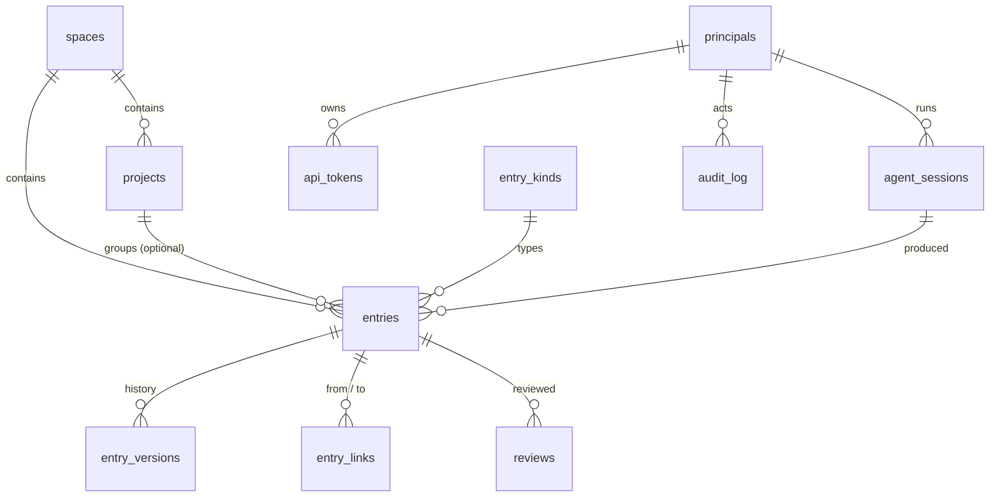
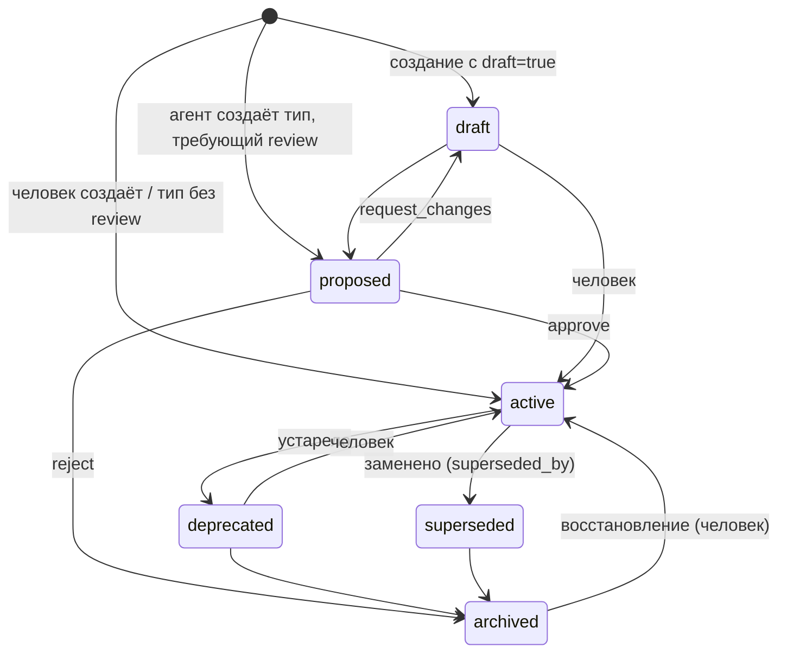

# Модель данных

## 1. Сущности



| Сущность | Назначение |
|----------|------------|
| `spaces` | Изолированное пространство: `personal`, `work`, `shared`. Граница прав доступа. |
| `principals` | Кто действует: человек (`user`), агент (`agent`), служебный процесс (`system`). Например `me`, `claude-code@work`, `cursor@personal`. |
| `api_tokens` | Токены principal'ов со scope'ами. Хранится только hash. |
| `projects` | Проект внутри пространства (репозиторий, область работы). Привязка к `git remote` для автоопределения. |
| `entry_kinds` | Реестр типов знаний с JSON Schema для `attributes`. Расширяется данными. |
| `entries` | Единица знания. Текущая версия. |
| `entry_versions` | Неизменяемые снимки всех версий записи. |
| `entry_links` | Типизированные связи между записями (граф знаний). |
| `agent_sessions` | Сессия работы агента — провенанс записей. |
| `reviews` | Решения по проверке записей. |
| `audit_log` | Журнал всех изменений и использований токенов. |
| `idempotency_keys` | Защита от дублей при повторах запросов агентами. |

### Типы записей (`entry_kinds`, начальный набор)

| kind | Что это | `attributes` | Review для агентов |
|------|---------|--------------|--------------------|
| `note` | Свободная заметка | — | нет |
| `fact` | Проверяемый факт о системе/домене | `{verified_at?, source?}` | да |
| `decision` | Архитектурное/техническое решение (ADR) | `{context, decision, alternatives[], consequences, decided_at}` | да |
| `rule` | Правило/конвенция для агентов («используем pnpm», «не трогать legacy/») | `{applies_to?: glob[]}` | да |
| `lesson` | Урок/грабли: что пошло не так и как избежать | `{symptom, cause, fix}` | нет |
| `document` | Длинный документ (спека, описание модуля) | `{format?: "md"}` | нет |
| `snippet` | Фрагмент кода/команды | `{language, command?}` | нет |
| `session_log` | Итог сессии агента | `{agent, outcomes[], files_touched[], goal, status (done/in_progress/blocked), done[], commits[], open_questions[], next_steps[], continues[]}` (миграция 0006) | нет |

«Review для агентов» означает: если запись создаёт principal типа `agent`, она получает статус `proposed`
и не попадает в контекст, пока человек её не подтвердит. Флаг можно переопределить на уровне пространства
(`spaces.settings.review_kinds`).

## 2. Жизненный цикл записи



| Статус | В поиске по умолчанию | В контексте |
|--------|-----------------------|-------------|
| `draft` | нет | нет |
| `proposed` | да, с пометкой | нет |
| `active` | да | да |
| `deprecated` | да, с пониженным весом | нет |
| `superseded` | только с фильтром | нет (вместо неё — заменившая) |
| `archived` | только с фильтром | нет |

Переходы проверяет `domain`-слой (`internal/domain/lifecycle.go`). Агенты не могут одобрять, восстанавливать из `archived`
и архивировать подтверждённые записи; могут помечать их `deprecated` или `superseded` — это видно в истории.
Агенты также не могут ставить `pinned`: закреплённые записи попадают в каждый контекст проекта.

## 4. Схема

Актуальная схема — миграции в `services/knowledge-api/internal/db/migrations/`:

| Миграция | Что делает |
|----------|------------|
| `0001_init.sql` | Схема ниже и права роли `kn_app` |
| `0002_seed.sql` | Пространства `personal` / `work` / `shared` (у `shared` — `agent_always_review`), principal `me`, начальные типы записей |
| `0003_search_attributes.sql` | Строковые значения `attributes` (контекст решения, симптом урока, …) тоже попадают в полнотекстовый индекс |

Отличия реализации от DDL ниже: `idempotency_keys.response` хранится как `bytea` (сырое тело ответа);
`kn_app` получает `SELECT` на `schema_migrations` (для `/readyz`); `search_tsv` включает атрибуты (миграция 0003).

## 3. Правила

- **Версионирование.** Любое изменение записи (включая статус и `pinned`) увеличивает `version`. Обновление требует `expected_version` (HTTP `If-Match`) — оптимистическая блокировка: два агента не перетрут друг друга.
- **Провенанс обязателен.** `created_by`, `updated_by` — всегда; `session_id` и `source_ref` (путь/URL/коммит) — для агентских записей.
- **Проект и пространство согласованы.** Составной FK `(space_id, project_id) → projects(space_id, id)`: запись не может ссылаться на проект из чужого пространства.
- **Перенос между пространствами** — не `UPDATE space_id`, а операция `promote` (копия в целевом пространстве со ссылкой `derived_from`). Так перенос work → shared всегда виден в аудите и требует права на запись в целевое пространство.
- **Нормализация для `content_hash`:** `sha256(kind || 0x00 || lower(trim(title)) || 0x00 || схлопнутые пробелы в body)`. Используется для точной дедупликации.
- **`body_hash`** (миграция 0004): generated-колонка `kn_body_hash(body)` — md5 текста со схлопнутыми пробельными
  символами; `NULL` для текстов короче 200 символов. Ловит тот же текст под другим заголовком: предупреждение при
  записи, пометка в очереди проверки, отчёт импорта, детектор дублей в отчёте о здоровье. Индекс не уникальный —
  схема копии не запрещает, решает человек.

### DDL (исходный вариант `0001_init.sql`)

```sql
-- +goose Up
CREATE EXTENSION IF NOT EXISTS pg_trgm;
CREATE EXTENSION IF NOT EXISTS vector;   -- ставим сразу, используем в фазе 3

-- ── Пространства и участники ───────────────────────────────────────────────

CREATE TABLE spaces (
    id          uuid PRIMARY KEY,
    slug        text NOT NULL UNIQUE CHECK (slug ~ '^[a-z][a-z0-9-]{1,31}$'),
    name        text NOT NULL,
    settings    jsonb NOT NULL DEFAULT '{}',      -- {review_kinds: [...], ...}
    created_at  timestamptz NOT NULL DEFAULT now()
);

CREATE TABLE principals (
    id          uuid PRIMARY KEY,
    kind        text NOT NULL CHECK (kind IN ('user', 'agent', 'system')),
    name        text NOT NULL UNIQUE,             -- 'me', 'claude-code@work'
    description text NOT NULL DEFAULT '',
    created_at  timestamptz NOT NULL DEFAULT now(),
    disabled_at timestamptz
);

CREATE TABLE api_tokens (
    id           uuid PRIMARY KEY,
    principal_id uuid NOT NULL REFERENCES principals(id),
    name         text NOT NULL,
    prefix       text NOT NULL UNIQUE,            -- публичная часть токена, видна в логах
    secret_hash  bytea NOT NULL,                  -- sha256(secret); секрет 256 бит, bcrypt не нужен
    scopes       text[] NOT NULL CHECK (cardinality(scopes) > 0),
    expires_at   timestamptz,
    last_used_at timestamptz,
    created_at   timestamptz NOT NULL DEFAULT now(),
    revoked_at   timestamptz
);

-- ── Проекты и типы ─────────────────────────────────────────────────────────

CREATE TABLE projects (
    id          uuid PRIMARY KEY,
    space_id    uuid NOT NULL REFERENCES spaces(id),
    slug        text NOT NULL CHECK (slug ~ '^[a-z0-9][a-z0-9._-]{0,63}$'),
    name        text NOT NULL,
    description text NOT NULL DEFAULT '',
    repo_urls   text[] NOT NULL DEFAULT '{}',     -- нормализованные git remote, для автоопределения
    metadata    jsonb NOT NULL DEFAULT '{}',
    created_at  timestamptz NOT NULL DEFAULT now(),
    updated_at  timestamptz NOT NULL DEFAULT now(),
    archived_at timestamptz,
    UNIQUE (space_id, slug),
    UNIQUE (space_id, id)                         -- цель составного FK из entries
);
CREATE INDEX projects_repo_urls_idx ON projects USING gin (repo_urls);

CREATE TABLE entry_kinds (
    kind                  text PRIMARY KEY CHECK (kind ~ '^[a-z][a-z0-9_]{1,31}$'),
    description           text NOT NULL,
    attributes_schema     jsonb NOT NULL DEFAULT '{}',   -- JSON Schema для entries.attributes
    agent_requires_review boolean NOT NULL DEFAULT false
);

-- ── Сессии агентов ─────────────────────────────────────────────────────────

CREATE TABLE agent_sessions (
    id           uuid PRIMARY KEY,
    principal_id uuid NOT NULL REFERENCES principals(id),
    space_id     uuid NOT NULL REFERENCES spaces(id),
    project_id   uuid,
    agent        text NOT NULL,                   -- 'claude-code', 'cursor', 'codex', ...
    client_info  jsonb NOT NULL DEFAULT '{}',     -- версия, модель, cwd, ветка
    started_at   timestamptz NOT NULL DEFAULT now(),
    ended_at     timestamptz,
    FOREIGN KEY (space_id, project_id) REFERENCES projects (space_id, id)
);

-- ── Записи ─────────────────────────────────────────────────────────────────

CREATE TABLE entries (
    id            uuid PRIMARY KEY,
    space_id      uuid NOT NULL REFERENCES spaces(id),
    project_id    uuid,
    kind          text NOT NULL REFERENCES entry_kinds(kind),
    title         text NOT NULL CHECK (char_length(title) BETWEEN 3 AND 300),
    summary       text CHECK (char_length(summary) <= 1000),
    body          text NOT NULL DEFAULT '' CHECK (char_length(body) <= 200000),  -- markdown
    attributes    jsonb NOT NULL DEFAULT '{}',
    tags          text[] NOT NULL DEFAULT '{}',
    status        text NOT NULL CHECK (status IN
                    ('draft', 'proposed', 'active', 'deprecated', 'superseded', 'archived')),
    pinned        boolean NOT NULL DEFAULT false, -- всегда включать в контекст проекта
    confidence    real CHECK (confidence BETWEEN 0 AND 1),
    version       integer NOT NULL DEFAULT 1 CHECK (version > 0),
    content_hash  bytea NOT NULL,
    superseded_by uuid REFERENCES entries(id),
    review_after  date,                           -- когда перепроверить актуальность
    session_id    uuid REFERENCES agent_sessions(id),
    source_ref    text,                           -- путь, URL, коммит
    created_by    uuid NOT NULL REFERENCES principals(id),
    updated_by    uuid NOT NULL REFERENCES principals(id),
    created_at    timestamptz NOT NULL DEFAULT now(),
    updated_at    timestamptz NOT NULL DEFAULT now(),
    -- Конфигурация 'russian': кириллица — русский стеммер, латиница — английский.
    search_tsv    tsvector GENERATED ALWAYS AS (
                      setweight(to_tsvector('russian', title), 'A') ||
                      setweight(to_tsvector('russian', coalesce(summary, '')), 'B') ||
                      setweight(to_tsvector('russian', body), 'C')
                  ) STORED,
    FOREIGN KEY (space_id, project_id) REFERENCES projects (space_id, id),
    CHECK (status <> 'superseded' OR superseded_by IS NOT NULL)
);

CREATE INDEX entries_scope_idx   ON entries (space_id, project_id, status, updated_at DESC);
CREATE INDEX entries_kind_idx    ON entries (space_id, kind, status);
CREATE INDEX entries_pinned_idx  ON entries (space_id, project_id) WHERE pinned AND status = 'active';
CREATE INDEX entries_tsv_idx     ON entries USING gin (search_tsv);
CREATE INDEX entries_tags_idx    ON entries USING gin (tags);
CREATE INDEX entries_title_trgm  ON entries USING gin (title gin_trgm_ops);
CREATE INDEX entries_review_idx  ON entries (review_after) WHERE review_after IS NOT NULL;
-- Точные дубли запрещены среди «живых» записей пространства
CREATE UNIQUE INDEX entries_dedup_idx ON entries (space_id, content_hash)
    WHERE status NOT IN ('archived', 'superseded');

-- ── История ────────────────────────────────────────────────────────────────

CREATE TABLE entry_versions (
    entry_id    uuid NOT NULL REFERENCES entries(id),
    version     integer NOT NULL,
    project_id  uuid,
    kind        text NOT NULL,
    title       text NOT NULL,
    summary     text,
    body        text NOT NULL,
    attributes  jsonb NOT NULL,
    tags        text[] NOT NULL,
    status      text NOT NULL,
    pinned      boolean NOT NULL,
    changed_by  uuid NOT NULL REFERENCES principals(id),
    change_note text,
    created_at  timestamptz NOT NULL DEFAULT now(),
    PRIMARY KEY (entry_id, version)
);

-- +goose StatementBegin
CREATE FUNCTION entries_snapshot() RETURNS trigger LANGUAGE plpgsql AS $$
BEGIN
    IF TG_OP = 'UPDATE' AND NEW.version <> OLD.version + 1 THEN
        RAISE EXCEPTION 'entries.version must be incremented by 1 (old %, new %)', OLD.version, NEW.version;
    END IF;
    INSERT INTO entry_versions (entry_id, version, project_id, kind, title, summary, body,
                                attributes, tags, status, pinned, changed_by, change_note)
    VALUES (NEW.id, NEW.version, NEW.project_id, NEW.kind, NEW.title, NEW.summary, NEW.body,
            NEW.attributes, NEW.tags, NEW.status, NEW.pinned, NEW.updated_by,
            nullif(current_setting('app.change_note', true), ''));  -- SET LOCAL из сервиса
    RETURN NULL;
END $$;
-- +goose StatementEnd

CREATE TRIGGER entries_history AFTER INSERT OR UPDATE ON entries
    FOR EACH ROW EXECUTE FUNCTION entries_snapshot();

-- ── Связи, review, аудит ───────────────────────────────────────────────────

CREATE TABLE entry_links (
    from_id    uuid NOT NULL REFERENCES entries(id),
    to_id      uuid NOT NULL REFERENCES entries(id),
    rel        text NOT NULL CHECK (rel IN
                 ('relates_to', 'depends_on', 'supersedes', 'derived_from', 'contradicts', 'references')),
    created_by uuid NOT NULL REFERENCES principals(id),
    created_at timestamptz NOT NULL DEFAULT now(),
    PRIMARY KEY (from_id, to_id, rel),
    CHECK (from_id <> to_id)
);
CREATE INDEX entry_links_to_idx ON entry_links (to_id);

CREATE TABLE reviews (
    id            uuid PRIMARY KEY,
    entry_id      uuid NOT NULL REFERENCES entries(id),
    entry_version integer NOT NULL,
    reviewer_id   uuid NOT NULL REFERENCES principals(id),
    action        text NOT NULL CHECK (action IN ('approve', 'reject', 'request_changes')),
    comment       text,
    created_at    timestamptz NOT NULL DEFAULT now()
);

CREATE TABLE audit_log (
    id           bigint GENERATED ALWAYS AS IDENTITY PRIMARY KEY,
    at           timestamptz NOT NULL DEFAULT now(),
    principal_id uuid REFERENCES principals(id),
    token_id     uuid REFERENCES api_tokens(id),
    space_id     uuid REFERENCES spaces(id),
    action       text NOT NULL,          -- 'entry.create', 'entry.update', 'search', 'context', 'token.create', ...
    target_type  text,
    target_id    uuid,
    details      jsonb NOT NULL DEFAULT '{}'   -- без содержимого записей; для поиска — hash запроса и число результатов
);
CREATE INDEX audit_log_at_idx     ON audit_log (at DESC);
CREATE INDEX audit_log_target_idx ON audit_log (target_id);

CREATE TABLE idempotency_keys (
    principal_id uuid NOT NULL REFERENCES principals(id),
    key          text NOT NULL,
    request_hash bytea NOT NULL,
    status_code  integer NOT NULL,
    response     jsonb NOT NULL,
    created_at   timestamptz NOT NULL DEFAULT now(),
    PRIMARY KEY (principal_id, key)
);   -- чистится фоновой задачей старше 24 ч

-- ── Права роли приложения ──────────────────────────────────────────────────
-- kn_owner владеет схемой и выполняет миграции; kn_app — рантайм сервиса.

GRANT SELECT, INSERT, UPDATE         ON spaces, principals, api_tokens, projects,
                                        entry_kinds, agent_sessions, entries TO kn_app;
GRANT SELECT, INSERT                 ON entry_versions, reviews, audit_log TO kn_app;
GRANT SELECT, INSERT, DELETE         ON entry_links, idempotency_keys TO kn_app;
-- DELETE на entries / entry_versions / audit_log не выдаётся намеренно.
```


### Сроки актуальности (`entry_kinds.review_days`, миграция 0007, ADR-12)

У типа может быть срок перепроверки в днях: факты и сниппеты — 180, уроки и правила — 365, решения, заметки,
документы и логи сессий — без срока. Дата перепроверки активной записи вычисляется при чтении:
`coalesce(review_after, updated_at::date + review_days)` — без переписывания существующих записей. Одобрение в
«На проверке» правит запись и тем продлевает срок.

### Снимки здоровья (`health_snapshots`, миграция 0008, ADR-13)

`(day PK, score, severity, live_entries, checks jsonb {<check>: {severity, count}})`. Одна строка в день — первая
(`ON CONFLICT DO NOTHING`). Только агрегаты, без заголовков; читает только глобальный админ. У `kn_app` — SELECT, INSERT.

### Использование записей (`entry_usage`, миграция 0005, ADR-9)

Дневные счётчики по записи: `shown` — в результатах поиска, `delivered` — в пакете `kn_context`, `opened` — полное
чтение через `GET /v1/entries/{id}`. Ключ `(entry_id, day)`, upsert одной командой на вызов. Принципала и текста
запроса нет намеренно. Прогоны `kn eval`, отчёт о здоровье и экспорт не считаются. У `kn_app` — SELECT, INSERT,
UPDATE, без DELETE.

## 5. Фаза 3: семантический поиск (не в MVP)

```sql
CREATE TABLE entry_chunks (
    entry_id      uuid NOT NULL REFERENCES entries(id),
    entry_version integer NOT NULL,
    chunk_no      integer NOT NULL,
    content       text NOT NULL,
    model         text NOT NULL,                  -- модель эмбеддингов, напр. локальная через Ollama
    embedding     vector(1024) NOT NULL,          -- размерность фиксируется под выбранную модель
    created_at    timestamptz NOT NULL DEFAULT now(),
    PRIMARY KEY (entry_id, chunk_no, model)
);
CREATE INDEX entry_chunks_hnsw ON entry_chunks USING hnsw (embedding vector_cosine_ops);
```

- Эмбеддинги считает отдельный воркер (не API), чтобы ядро не зависело от провайдера; модель — локальная по умолчанию.
- Чанки пересчитываются, когда `entries.version` > `entry_chunks.entry_version`.
- Смена модели = новые строки с другим `model`, старые удаляются после переиндексации.

## 6. Что сознательно не моделируем в MVP

- Задачи/трекер — для этого есть свои инструменты.
- Вложения (бинарные файлы) — только ссылки в `source_ref`/`body`.
- Иерархия папок — заменяется проектами, тегами и связями.
- Мультипользовательность — `principals` её допускает, но MVP рассчитан на одного человека.
