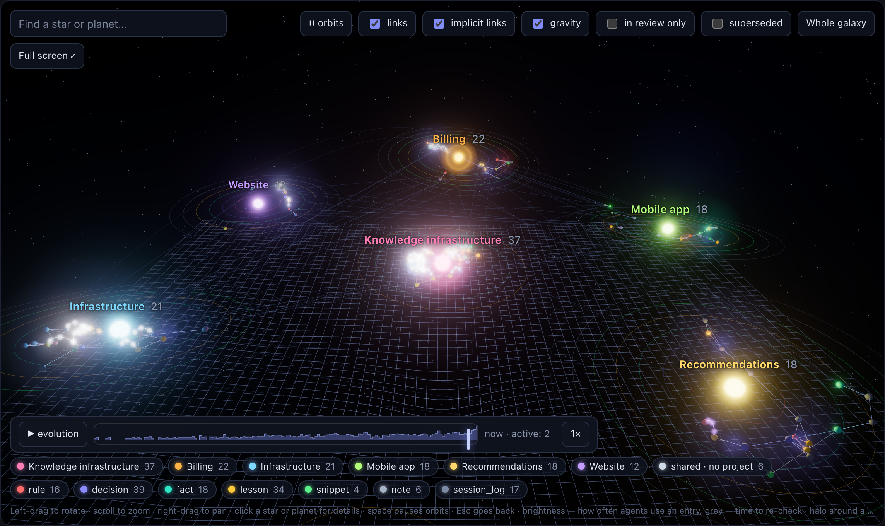

# kn playbook

[Русская версия](playbook.ru.md)

How kn is meant to be used day to day: the entities it is made of, how knowledge is moderated, ages and gets
updated, how agents hand work over to each other, and what you see in the web UI — including what the Galaxy
actually means.

- [1. Mental model](#1-mental-model)
- [2. Entities](#2-entities)
- [3. Lifecycle and moderation](#3-lifecycle-and-moderation)
- [4. Freshness: knowledge ages](#4-freshness-knowledge-ages)
- [5. Links](#5-links)
- [6. What an agent receives: context](#6-what-an-agent-receives-context)
- [7. Sessions and handoff](#7-sessions-and-handoff)
- [8. Keeping the base healthy](#8-keeping-the-base-healthy)
- [9. Web UI tour](#9-web-ui-tour)
- [10. The Galaxy](#10-the-galaxy)
- [11. Updating and moving data](#11-updating-and-moving-data)
- [12. Routines](#12-routines)
- [13. FAQ](#13-faq)

---

## 1. Mental model

kn is a **shared, typed memory** for every AI tool you use. Agents read it at the start of a task and write to it
when they learn something worth keeping. You stay the editor: agents propose, you approve what becomes binding.

Three rules make it work:

1. **One source of truth.** Knowledge lives in kn, not in a tool's private memory or scattered notes. Agent files
   (`CLAUDE.md`, `.cursor/rules`, `AGENTS.md`) can be *generated* from kn (`kn skill export`).
2. **Typed records, not a diary.** A decision, a rule, a lesson and a fact are different things with different
   lifetimes and different trust.
3. **Nothing is lost.** Every change is a version, nothing is ever deleted — outdated knowledge is marked, not erased.

## 2. Entities

| Entity | What it is | Where you see it |
|--------|-----------|------------------|
| **Space** | Isolation boundary: `personal`, `work`, `shared`. A token sees only the spaces in its scopes. | Every entry and project belongs to one |
| **Project** | A unit of work bound to one or more repositories (git remote, or a folder path without a remote). Agents find their project from the repository they run in. | «Projects», stars in the Galaxy |
| **Entry** | One piece of knowledge of a certain **kind**, with title, summary, body, tags, attributes and status. | Search, entry page, planets |
| **Kind** | Type of entry with a JSON Schema for its attributes, whether agents' entries need review, and how often it must be re-checked. Extensible in the UI without code. | «Entry kinds» |
| **Link** | Typed relation between two entries: `relates_to`, `depends_on`, `derived_from`, `references`, `supersedes`, `contradicts`. | Entry page, curves in the Galaxy |
| **Principal & token** | Who acts: a human (`me`) or an agent (`claude-code@personal`). Each agent has its own token with scopes like `space:personal:write space:shared:read`. | «Access & tokens», audit |
| **Agent session** | One working session of an agent in a project. Entries an agent writes are tied to it (provenance). | Health, audit |
| **Session log** | The structured result of a session: summary, goal, done, commits, next steps, open questions, status. | «Unfinished work» in context |
| **Version** | Snapshot of an entry after each change; any version can be restored. | Entry → History |
| **Review** | A human decision on an agent's entry: approve, reject, request changes. | «Review» |

### Kinds

| Kind | Use for | Agent entries need review | Re-check every |
|------|---------|:---:|---|
| `decision` | A choice of approach with context, alternatives and consequences (ADR) | yes | — |
| `rule` | A standing rule of the project the agent must follow | yes | 365 days |
| `fact` | A verified fact about the system or environment | yes | 180 days |
| `lesson` | A pitfall and how to avoid it | no | 365 days |
| `snippet` | A piece of code or a command | no | 180 days |
| `note`, `document` | Free-form notes and longer documents | no | — |
| `session_log` | Session result (written via `kn_log_session`) | no | — |

All of this is configurable on the «Entry kinds» page.

### Statuses

```
draft ──► proposed ──approve──► active ──► deprecated
  ▲          │                     │
  └─changes──┤                     └────► superseded (by a newer entry)
             └──reject──► archived (out of the way, kept forever)
```

- **draft** — not visible to agents until activated.
- **proposed** — waiting for review; not in agents' context yet.
- **active** — binding; goes to agents.
- **deprecated** — no longer true, kept for history.
- **superseded** — replaced by a specific newer entry (`superseded_by`).
- **archived** — hidden from normal views.

## 3. Lifecycle and moderation

**Who writes what**

- **You** (through the UI or `kn save`): your entries are active immediately.
- **Agents**: lessons, notes, snippets and session logs are active immediately; **decisions, rules and facts go to
  review** — they shape what every future agent does, so a human confirms them. Anything an agent writes into
  `shared` always goes to review.
- Every agent entry must carry **provenance**: the session it came from or a `source_ref` (file, URL, chat).

**Review** («Review» page or `kn review`)

- *Approve* (`a`) — becomes active and starts its freshness clock.
- *Reject* (`r`) — archived with your comment: kept for history, never shown to agents.
- *Request changes* — back to draft with your comment; the author fixes it and proposes again.
- Keyboard: `j`/`k` to move, `a`/`r` to act, `x` to select for bulk actions.

**Edits.** Agents may edit active entries directly (`kn_update`), without another review: every edit is a new
version visible in history and audit, and you can revert any of them. Concurrent edits are caught with optimistic
locking (the agent re-reads and retries).

**Quality gates on every write**: schema of the kind, secret scanner (keys, tokens, passwords — rejected with no
bypass for agents), duplicate detection (same text, similar titles), suggested links to related knowledge.

**Nothing is deleted.** The service's database role has no `DELETE` on entries, history and audit. Mistakes are
fixed by status changes and reverts.

**Promotion.** Good knowledge from a project can be promoted to `shared` (`kn promote`) so every profile sees it.

## 4. Freshness: knowledge ages

Facts and rules rot. Each kind has a **re-check period** (facts and snippets 180 days, lessons and rules 365,
decisions and notes never); an entry can also have an explicit `review_after` date.

When the date passes:

- the entry appears in «Review» with an *overdue* mark;
- agents still get it, but marked **«time to re-check»**;
- `kn_get` warns about it;
- in the Galaxy the planet **fades to grey**.

Approving it again (or editing it) restarts the clock. If it is no longer true — deprecate it or supersede it with
the corrected version.

**Usage signal.** kn counts per day how often each entry was delivered to agents (search, context) and opened —
without storing who asked or what. Entries nobody used for a long time show up in the health report as *unused*;
in the Galaxy, used knowledge glows brighter.

## 5. Links

Links turn a pile of notes into knowledge that explains itself:

| Link | Meaning |
|------|---------|
| `relates_to` | about the same topic |
| `depends_on` | this is valid only while that is |
| `derived_from` | this rule/lesson came out of that incident/decision |
| `references` | mentions, points to |
| `supersedes` | replaces (set automatically when you supersede) |
| `contradicts` | these two disagree — someone must resolve it |

Why they matter: context includes linked knowledge together; health checks find **dependencies on retired
knowledge** and **unresolved contradictions**; the Galaxy pulls linked entries together.

**Implicit links.** Entries that talk about the same thing without an explicit link are found by content (shared
characteristic words, rare tags, the same source). They are shown faintly in the Galaxy and suggested as
«Link» buttons — one click turns them into explicit links.

## 6. What an agent receives: context

`kn_context` (and the Claude Code start hook) packs a budget of tokens (10 000 by default; the hook uses 2 700
because Claude Code truncates long hook output) with, in order of priority:

1. **Rules** and **pinned** entries of the project (up to 35 % of the budget);
2. **Unfinished work** — session logs left *in progress* by previous agents;
3. **Relevant to the task** — search by the task description across decisions, lessons, facts;
4. recent **decisions**, **lessons**, **facts**;
5. a **table of contents** of what did not fit (`id — title`), so the agent can open it with `kn_get`.

Entries past their re-check date are marked. Write a short, specific task description — it decides what lands in
section 3.

## 7. Sessions and handoff

A session starts when an agent first talks to kn in a project and ends with **`kn_log_session`**:

- `summary`, `goal`, `done`, `commits`, `files_touched`;
- `next_steps`, `open_questions` — if present, the status becomes **in_progress**;
- `outcomes` — new lessons/facts/rules saved as separate entries in the same call.

The next agent in this project — in any tool — sees *in progress* logs under **«Unfinished work»** in its context.
When it picks one up, it passes its id in `continues`; the old log is closed. Logs nobody continued for 14 days show
up in the health report; after 30 days they stop appearing in context.

This is how you can start in Cursor, continue in Claude Code tomorrow, and ask ChatGPT about it on your phone.

## 8. Keeping the base healthy

«Health» page / `kn health` / agents via `kn_health` (read-only). The score and its daily trend are on the page.

| Check | What it finds |
|-------|---------------|
| Duplicates by content | same text in several entries |
| Near-duplicate titles | similar titles, different text, no link |
| Contradictions | `contradicts` between live entries |
| Depending on retired knowledge | live entries that depend on deprecated/superseded ones |
| Broken supersede | replaced by something that is itself outdated |
| Overdue re-check | past the freshness date |
| Review backlog | agents' entries waiting too long |
| Orphans | decisions, rules, lessons, facts with no links |
| Incomplete entries | decisions without alternatives, lessons without a fix, long text without summary |
| Rules over budget | rules that do not fit into the context budget |
| Unused | not delivered or opened for a long time |
| Search without results | empty searches, repeated ones = missing knowledge |
| Open sessions, stale handoffs | work that ended without a log, or was abandoned |
| Access risks | agent tokens writing to `shared`, tokens unused for long |

Fixes are always done by a human (buttons «Keep this», «Link», «Replace» on the page), never automatically.

## 9. Web UI tour

Open it with `make ui` (or `kn ui`) — you are signed in automatically. Language and theme follow your system and can
be switched at the bottom of the sidebar.

| Page | What for |
|------|----------|
| **Overview** | counters, the **Galaxy** and the **Link graph** |
| **Review** | the moderation queue: agents' proposals, overdue re-checks, duplicate hints |
| **Search & entries** | full-text search (Russian and English word forms), filters by kind, project, status |
| **Entry** | text, attributes, links (add/remove), **history with diffs and revert**, usage over 30 days |
| **New entry** | write knowledge yourself; it is active immediately (or save as draft) |
| **Projects** | projects and their repositories; archive |
| **Health** | the report above with one-click fixes and the score trend |
| **Access & tokens** *(admin)* | principals, scopes, issue/revoke tokens |
| **Audit** *(admin)* | who did what and when |
| **Entry kinds** *(admin)* | kinds, their schemas, review flags and re-check periods |
| **Export & import** *(admin)* | JSONL (full, restorable) and Markdown (Obsidian) |

## 10. The Galaxy

The Galaxy is not decoration: every visual property encodes something real about your knowledge.



| You see | It means |
|---------|----------|
| **Star** | a project (or a space's entries without a project) |
| **Planet** | an entry; colour = kind, **size = volume of text** (radius ∝ ∛characters) |
| **Orbits** | each kind has its home orbit: rules closest to the star, then decisions, facts, lessons… documents in the outer belt |
| **Brightness** | how often agents actually use the entry (90 days) |
| **Grey planet** | time to re-check |
| **Extra-bright planet** | proposed, waiting for review |
| **Curves with sparks** | explicit links, coloured by type; sparks flow from source to target |
| **Faint straight lines** | implicit links (same topic, found by content) |
| **Nebula** | a bound group — entries pulling each other hard enough to orbit the star together |
| **Ring around a planet (halo)** | the selected entry |
| **Gravity well** (grid underneath) | weight of each system Φ = volume of knowledge × cohesion; deeper well — heavier project |
| **Galactic core** | the heaviest project; heavy projects sink towards the centre, cross-project links pull stars together |
| **Halo around a star** | the project is being developed right now. Brightness and size = entry revisions and agent sessions over the last 24 hours, recent work weighs more. A quiet day — the halo goes out |

Physics: links are gravity. Explicit links pull hard, implicit ones weakly; light entries move towards heavy ones;
free planets follow Kepler (inner orbits are faster); systems orbit the core with the weight enclosed by their orbit.

**Evolution player.** Press **▶ evolution** under the map: the whole history replays in ~40 seconds (1× / 4× / 12×).
Entries appear when they were written, links when they were made, stars swell as knowledge accumulates, halos light up
when work happened. Drag the slider to any moment; the strip behind it is activity over time. **● now** returns to
the live view.

Controls: drag — rotate, wheel — zoom, right drag — pan, click a star or planet — details (and a «Link» button for
implicit neighbours), space — pause orbits, Esc — back. Search finds stars and planets by name; chips at the bottom
filter by project and kind.

## 11. Updating and moving data

- **Agents** update knowledge with `kn_update` (they see the version and must pass it back) and supersede outdated
  entries with corrected ones.
- **You** edit on the entry page; every save is a version.
- **Generated agent files**: `kn skill export` writes approved rules and decisions of a project into
  `.claude/skills/`, `.cursor/rules/` and `AGENTS.md`; `--check` fails CI when they are stale.
- **Export/import**: `kn export --format jsonl` is a complete, restorable dump (with `--history` for versions);
  `kn import` brings it back (or into another person's kn). `--format markdown` produces an Obsidian vault.
- **Sharing with a colleague**: export the project to JSONL, they `kn import` it into their own kn. There is no
  multi-user server mode — each person runs their own kn.
- **Backups**: `pg_dump` daily (14 kept) in `deploy/backups/`; `make restore-test` proves the latest one restores.

## 12. Routines

**New project** — `kn project create personal/<slug> --repo-from-cwd` (or let the agent call `kn_project`), then
ask the agent to record the first decisions.

**Every session** — nothing to do: context arrives by itself; the agent saves as it goes and ends with
`kn_log_session`. Help it with a clear task description.

**Weekly (10 minutes)**

1. «Review»: approve or reject agents' decisions, rules and facts; re-confirm overdue entries.
2. «Health»: merge duplicates, link orphans, resolve contradictions.
3. Glance at the Galaxy: which projects glow with a halo, which went quiet, which planets are grey.

**Monthly** — `kn skill export --check` in active repos; `make restore-test`; prune tokens you no longer use.

## 13. FAQ

**Can agents break things?** They cannot delete anything, their binding knowledge waits for you, and every edit
can be reverted.

**Do I need embeddings / an LLM inside kn?** No. Search is PostgreSQL full-text with a fallback for natural-language
phrases; measured with `kn eval`, it did not need vectors so far.

**Is it safe to run for work?** Use a separate `work` profile: its tokens never see `personal`. kn binds to
`127.0.0.1` only. Do not connect ChatGPT to `work` — whatever it reads goes to OpenAI.

**Why do agents' texts and context headings appear in Russian?** The agent-facing layer (MCP tool descriptions,
context headings) is Russian for now; English is on the roadmap. Agents handle both languages fine.
