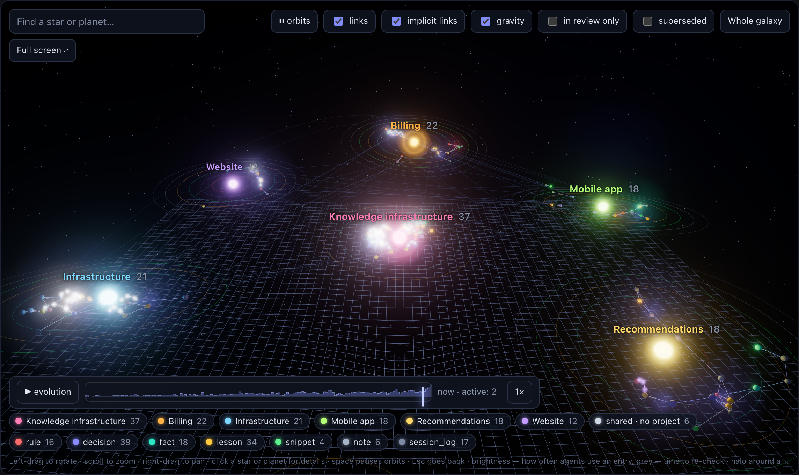

# Playbook kn

[English version](playbook.md)

Как пользоваться kn каждый день: из каких сущностей он состоит, как знания проходят модерацию, стареют и
обновляются, как агенты передают друг другу работу, что показывает веб-интерфейс и что на самом деле означает
Галактика.

- [1. Модель в голове](#1-модель-в-голове)
- [2. Сущности](#2-сущности)
- [3. Жизненный цикл и модерация](#3-жизненный-цикл-и-модерация)
- [4. Актуальность: знания стареют](#4-актуальность-знания-стареют)
- [5. Связи](#5-связи)
- [6. Что получает агент: контекст](#6-что-получает-агент-контекст)
- [7. Сессии и передача работы](#7-сессии-и-передача-работы)
- [8. Здоровье базы](#8-здоровье-базы)
- [9. Веб-интерфейс](#9-веб-интерфейс)
- [10. Галактика](#10-галактика)
- [11. Обновление и перенос данных](#11-обновление-и-перенос-данных)
- [12. Ритуалы](#12-ритуалы)
- [13. Вопросы и ответы](#13-вопросы-и-ответы)

---

## 1. Модель в голове

kn — **общая типизированная память** для всех ваших AI-инструментов. Агенты читают её в начале задачи и пишут в неё,
когда узнают что-то стоящее. Редактор — вы: агенты предлагают, вы утверждаете то, что становится обязательным.

Работает это на трёх правилах:

1. **Один источник правды.** Знания живут в kn, а не в личной памяти инструмента или в разрозненных заметках.
   Файлы агентов (`CLAUDE.md`, `.cursor/rules`, `AGENTS.md`) можно *генерировать* из kn (`kn skill export`).
2. **Типизированные записи, а не дневник.** Решение, правило, урок и факт — разные вещи с разным сроком жизни
   и разным доверием.
3. **Ничего не теряется.** Каждая правка — версия, ничего не удаляется: устаревшее помечается, а не стирается.

## 2. Сущности

| Сущность | Что это | Где видно |
|----------|---------|-----------|
| **Пространство** | Граница изоляции: `personal`, `work`, `shared`. Токен видит только пространства из своих scope. | Каждая запись и проект принадлежат одному |
| **Проект** | Единица работы, привязанная к репозиториям (git remote, а без remote — путь к папке). Агент находит свой проект по репозиторию, в котором запущен. | «Проекты», звёзды в Галактике |
| **Запись** | Одно знание определённого **типа**: заголовок, суть, текст, теги, атрибуты, статус. | Поиск, страница записи, планеты |
| **Тип записи** | JSON Schema атрибутов, нужна ли проверка записям агентов, как часто перепроверять. Новый тип добавляется в интерфейсе без кода. | «Типы записей» |
| **Связь** | Типизированное отношение двух записей: `relates_to`, `depends_on`, `derived_from`, `references`, `supersedes`, `contradicts`. | Страница записи, дуги в Галактике |
| **Принципал и токен** | Кто действует: человек (`me`) или агент (`claude-code@personal`). У каждого агента свой токен со scope вроде `space:personal:write space:shared:read`. | «Доступ и токены», аудит |
| **Сессия агента** | Один рабочий сеанс агента в проекте. Записи агента привязаны к ней (провенанс). | Здоровье, аудит |
| **Итог сессии** | Структурированный результат: суть, цель, сделано, коммиты, следующие шаги, открытые вопросы, статус. | «Незавершённая работа» в контексте |
| **Версия** | Снимок записи после каждой правки; любую можно вернуть. | Запись → История |
| **Проверка** | Решение человека по записи агента: одобрить, отклонить, вернуть на доработку. | «На проверке» |

### Типы записей

| Тип | Для чего | Записи агентов на проверку | Перепроверять каждые |
|-----|----------|:---:|---|
| `decision` | Выбор подхода с контекстом, альтернативами и последствиями (ADR) | да | — |
| `rule` | Устойчивое правило проекта, которое агент обязан соблюдать | да | 365 дней |
| `fact` | Проверенный факт о системе или окружении | да | 180 дней |
| `lesson` | Грабли и как их обойти | нет | 365 дней |
| `snippet` | Кусок кода или команда | нет | 180 дней |
| `note`, `document` | Заметки и длинные документы | нет | — |
| `session_log` | Итог сессии (пишется через `kn_log_session`) | нет | — |

Всё это настраивается на странице «Типы записей».

### Статусы

```
draft ──► proposed ──одобрить──► active ──► deprecated
  ▲          │                     │
  └─вернуть──┤                     └────► superseded (заменена новой записью)
             └──отклонить──► archived (убрана с глаз, хранится навсегда)
```

- **draft** — черновик, агентам не виден, пока не активирован.
- **proposed** — ждёт проверки, в контекст агентов ещё не попадает.
- **active** — действующая, идёт агентам.
- **deprecated** — больше не верна, хранится для истории.
- **superseded** — заменена конкретной новой записью (`superseded_by`).
- **archived** — скрыта из обычных списков.

## 3. Жизненный цикл и модерация

**Кто что пишет**

- **Вы** (в интерфейсе или `kn save`): ваши записи активны сразу.
- **Агенты**: уроки, заметки, сниппеты и итоги сессий активны сразу; **решения, правила и факты идут на проверку** —
  они определяют поведение всех будущих агентов, поэтому их подтверждает человек. Всё, что агент пишет в `shared`,
  идёт на проверку всегда.
- У каждой записи агента обязателен **провенанс**: сессия, из которой она пришла, или `source_ref` (файл, URL, чат).

**Проверка** (страница «На проверке» или `kn review`)

- *Одобрить* (`a`) — запись становится активной, запускается её срок актуальности.
- *Отклонить* (`r`) — уходит в архив с вашим комментарием: хранится для истории, агентам не показывается.
- *Вернуть на доработку* — обратно в черновик с комментарием; автор правит и предлагает снова.
- Клавиши: `j`/`k` — перемещение, `a`/`r` — действие, `x` — выбрать для массовых действий.

**Правки.** Агенты правят активные записи напрямую (`kn_update`), без повторной проверки: каждая правка — новая
версия, видна в истории и аудите, любую можно откатить. Параллельные правки ловит оптимистическая блокировка
(агент перечитывает запись и повторяет).

**Проверки на каждой записи**: схема типа, сканер секретов (ключи, токены, пароли — отказ без возможности обхода
для агентов), поиск дублей (тот же текст, похожие заголовки), предложения связей с близкими знаниями.

**Ничего не удаляется.** У роли сервиса в БД нет `DELETE` на записи, историю и аудит. Ошибки исправляются сменой
статуса и откатом.

**Подъём в shared.** Хорошее знание проекта можно поднять в `shared` (`kn promote`) — его увидят все профили.

## 4. Актуальность: знания стареют

Факты и правила протухают. У каждого типа есть **срок перепроверки** (факты и сниппеты — 180 дней, уроки и
правила — 365, решения и заметки — без срока); у записи может быть и явная дата `review_after`.

Когда срок прошёл:

- запись появляется в «На проверке» с пометкой «просрочена»;
- агенты по-прежнему её получают, но с пометкой **«пора перепроверить»**;
- `kn_get` предупреждает об этом;
- в Галактике планета **сереет**.

Повторное одобрение (или правка) перезапускает срок. Если знание больше не верно — переведите в deprecated или
замените исправленной записью.

**Сигнал использования.** kn считает по дням, сколько раз запись выдана агентам (поиск, контекст) и открыта —
не храня, кто спрашивал и что. Давно невостребованные записи попадают в отчёт о здоровье; в Галактике
используемые знания светятся ярче.

## 5. Связи

Связи превращают кучу заметок в знания, которые объясняют сами себя:

| Связь | Смысл |
|-------|-------|
| `relates_to` | про одно и то же |
| `depends_on` | эта верна, пока верна та |
| `derived_from` | правило/урок выросло из того инцидента/решения |
| `references` | упоминает, ссылается |
| `supersedes` | заменяет (ставится автоматически при замене) |
| `contradicts` | эти две противоречат — кто-то должен разобраться |

Зачем: контекст приносит связанные знания вместе; отчёт о здоровье находит **опору на устаревшие знания** и
**неразрешённые противоречия**; в Галактике связанные записи притягиваются.

**Неявные связи.** Записи про одно и то же без явной связи находятся по содержанию (общие характерные слова, редкие
теги, один источник). В Галактике они показаны бледными линиями и предлагаются кнопкой «Связать» — один клик
делает связь явной.

## 6. Что получает агент: контекст

`kn_context` (и хук старта сессии Claude Code) укладывает в бюджет токенов (по умолчанию 10 000; в хуке — 2 700,
потому что Claude Code обрезает длинный вывод хука) по приоритету:

1. **правила** и **закреплённые** записи проекта (до 35 % бюджета);
2. **незавершённую работу** — итоги, оставленные предыдущими агентами *в работе*;
3. **связанное с задачей** — поиск по описанию задачи среди решений, уроков, фактов;
4. свежие **решения**, **уроки**, **факты**;
5. **оглавление** того, что не влезло (`id — заголовок`), чтобы агент открыл нужное через `kn_get`.

Записи с истёкшим сроком помечены. Пишите короткое конкретное описание задачи — от него зависит пункт 3.

## 7. Сессии и передача работы

Сессия начинается, когда агент впервые обращается к kn в проекте, и закрывается вызовом **`kn_log_session`**:

- `summary`, `goal`, `done`, `commits`, `files_touched`;
- `next_steps`, `open_questions` — если есть, статус становится **in_progress**;
- `outcomes` — новые уроки/факты/правила, сохраняются отдельными записями в том же вызове.

Следующий агент в этом проекте — в любом инструменте — видит итоги *в работе* в разделе **«Незавершённая работа»**.
Подхватив, он передаёт их id в `continues`, и старый итог закрывается. Итоги, которые 14 дней никто не продолжил,
попадают в отчёт о здоровье; через 30 дней они перестают попадать в контекст.

Так можно начать в Cursor, завтра продолжить в Claude Code и спросить ChatGPT с телефона, что там осталось.

## 8. Здоровье базы

Страница «Здоровье базы» / `kn health` / агенты через `kn_health` (только чтение). Балл и его ежедневный тренд —
на странице.

| Проверка | Что находит |
|----------|-------------|
| Дубли по содержимому | одинаковый текст в нескольких записях |
| Почти одинаковые заголовки | похожие заголовки, разный текст, нет связи |
| Противоречия | `contradicts` между живыми записями |
| Опора на устаревшие знания | живые записи зависят от deprecated/superseded |
| Замена на неактуальную запись | заменена тем, что само устарело |
| Просроченная перепроверка | прошёл срок актуальности |
| Очередь проверки | записи агентов ждут слишком долго |
| Знания без связей | решения, правила, уроки, факты без единой связи |
| Неполные записи | решения без альтернатив, уроки без исправления, длинный текст без сути |
| Правила не помещаются | правила не влезают в бюджет контекста |
| Невостребованные | давно не выдавались и не открывались |
| Поиск без результатов | пустые поиски; повторяющиеся — сигнал, что знания нет |
| Незакрытые сессии, брошенная работа | работа закончилась без итога или заброшена |
| Риски доступа | агентские токены с записью в `shared`, давно неиспользуемые токены |

Исправляет всегда человек (кнопки «Оставить эту», «Связать», «Заменить» на странице), автоматически — никогда.

## 9. Веб-интерфейс

Открывается командой `make ui` (или `kn ui`) — вход выполняется сам. Язык и тема следуют системным настройкам,
переключатели — внизу боковой панели.

| Страница | Зачем |
|----------|-------|
| **Обзор** | счётчики, **Галактика** и **Граф связей** |
| **На проверке** | очередь модерации: предложения агентов, просроченные перепроверки, подсказки о дублях |
| **Поиск и записи** | полнотекстовый поиск (русские и английские словоформы), фильтры по типу, проекту, статусу |
| **Запись** | текст, атрибуты, связи (добавить/убрать), **история с диффами и откатом**, использование за 30 дней |
| **Новая запись** | написать знание самому; активно сразу (или черновиком) |
| **Проекты** | проекты и их репозитории, архив |
| **Здоровье базы** | отчёт выше с исправлениями в один клик и трендом балла |
| **Доступ и токены** *(админ)* | принципалы, scope, выпуск и отзыв токенов |
| **Аудит** *(админ)* | кто, что и когда сделал |
| **Типы записей** *(админ)* | типы, их схемы, флаги проверки и сроки перепроверки |
| **Экспорт и импорт** *(админ)* | JSONL (полный, восстанавливаемый) и Markdown (Obsidian) |

## 10. Галактика

Галактика — не украшение: каждое визуальное свойство кодирует что-то реальное о ваших знаниях.



| Что видно | Что значит |
|-----------|------------|
| **Звезда** | проект (или записи пространства без проекта) |
| **Планета** | запись; цвет — тип, **размер — объём текста** (радиус ∝ ∛знаков) |
| **Орбиты** | у каждого типа своя орбита: правила ближе всего к звезде, затем решения, факты, уроки… документы — во внешнем поясе |
| **Яркость** | как часто агенты реально используют запись (90 дней) |
| **Серая планета** | пора перепроверить |
| **Особо яркая планета** | предложена, ждёт проверки |
| **Дуги с искрами** | явные связи, цвет — тип связи; искры бегут от источника к цели |
| **Бледные прямые** | неявные связи (одна тема, найдено по содержанию) |
| **Туманность** | связанная группа — записи, которые притягивают друг друга так сильно, что летят вокруг звезды вместе |
| **Кольцо вокруг планеты (гало)** | выбранная запись |
| **Гравитационный колодец** (сетка снизу) | вес системы Φ = объём знаний × связность; чем глубже колодец, тем тяжелее проект |
| **Ядро галактики** | самый тяжёлый проект; тяжёлые проекты тонут к центру, межпроектные связи сближают звёзды |
| **Гало вокруг звезды** | проект разрабатывается прямо сейчас. Яркость и размер — правки записей и сессии агентов за последние 24 часа, свежая работа весит больше. Сутки тишины — гало гаснет |

Физика: связи — это гравитация. Явные тянут сильно, неявные — слабо; лёгкие записи сдвигаются к тяжёлым; свободные
планеты движутся по Кеплеру (внутренние орбиты быстрее); системы обращаются вокруг ядра с весом, заключённым внутри
их орбиты.

**Плеер эволюции.** Кнопка **▶ эволюция** под картой проигрывает всю историю примерно за 40 секунд (1× / 4× / 12×):
записи появляются, когда их написали, связи — когда их поставили, звёзды растут по мере накопления знаний, гало
загорается, когда шла работа. Ползунок переносит в любой момент; полоса под ним — активность во времени.
**● сейчас** возвращает к живому виду.

Управление: перетаскивание — вращать, колесо — зум, правая кнопка — сдвиг, клик по звезде или планете — подробности
(и кнопка «Связать» для неявных соседей), пробел — пауза орбит, Esc — назад. Поиск находит звёзды и планеты по имени;
чипы внизу фильтруют по проекту и типу.

## 11. Обновление и перенос данных

- **Агенты** обновляют знания через `kn_update` (видят версию и обязаны передать её обратно) и заменяют устаревшие
  записи исправленными.
- **Вы** правите на странице записи; каждое сохранение — версия.
- **Файлы для агентов**: `kn skill export` пишет одобренные правила и решения проекта в `.claude/skills/`,
  `.cursor/rules/` и `AGENTS.md`; `--check` роняет CI, если они устарели.
- **Экспорт и импорт**: `kn export --format jsonl` — полный восстанавливаемый дамп (`--history` — с версиями);
  `kn import` загружает его обратно (или в kn другого человека). `--format markdown` — хранилище Obsidian.
- **Поделиться с коллегой**: экспортируйте проект в JSONL, коллега делает `kn import` в свой kn. Многопользовательского
  серверного режима нет — у каждого свой kn.
- **Бэкапы**: ежедневный `pg_dump` (хранятся 14) в `deploy/backups/`; `make restore-test` проверяет, что последний
  восстанавливается.

## 12. Ритуалы

**Новый проект** — `kn project create personal/<slug> --repo-from-cwd` (или пусть агент вызовет `kn_project`), затем
попросите агента записать первые решения.

**Каждая сессия** — ничего делать не нужно: контекст приходит сам, агент сохраняет по ходу и завершает
`kn_log_session`. Помогите ему понятным описанием задачи.

**Раз в неделю (10 минут)**

1. «На проверке»: одобрить или отклонить решения, правила и факты агентов; подтвердить просроченные.
2. «Здоровье базы»: слить дубли, связать одиночек, разобрать противоречия.
3. Взглянуть на Галактику: какие проекты светятся гало, какие затихли, какие планеты посерели.

**Раз в месяц** — `kn skill export --check` в активных репозиториях; `make restore-test`; отозвать ненужные токены.

## 13. Вопросы и ответы

**Агенты могут что-то сломать?** Удалить они ничего не могут, их обязательные знания ждут вашего одобрения,
любую правку можно откатить.

**Нужны ли embeddings / LLM внутри kn?** Нет. Поиск — полнотекстовый PostgreSQL с фолбэком для фраз на естественном
языке; по замерам `kn eval` векторы пока не понадобились.

**Можно ли использовать для работы?** Заведите отдельный профиль `work`: его токены никогда не видят `personal`.
kn слушает только `127.0.0.1`. Не подключайте ChatGPT к `work` — всё, что он прочитает, уходит в OpenAI.

**Почему описания инструментов и заголовки контекста у агентов на русском?** Слой, который видят агенты (описания
MCP-инструментов, заголовки контекста), пока русский; английский — в планах. Агенты понимают оба языка.
